<h1 align="center">तरंग Tarang FM</h1>

<p align="center"><b>An AI radio station in your language, where every voice is Sarvam Bulbul V4 Flash.</b></p>

<p align="center">🏆 <b>First place, Sarvam Bulbul Build Challenge</b></p>

<p align="center"><b>Try it in 10 seconds:</b> open the <a href="https://tarang-fm.dualmindlab.tech">live link</a> and press <b>Tune in</b>.</p>

<p align="center">
  <a href="https://github.com/harshbhx/tarang-fm/actions/workflows/ci-cd.yml"></a>
  <a href="https://tarang-fm.dualmindlab.tech"></a>
  
  
  <a href="LICENSE"></a>
</p>

<p align="center">
  <a href="https://youtu.be/QCj_nzPSRCE"></a>
  <br>
  <a href="https://youtu.be/QCj_nzPSRCE"><b>▶ Watch the demo</b></a>
</p>

Press **Tune in** and a show starts: a jingle, an RJ who greets you by name with something true about your city today, an All India Radio style bulletin of real news from your own city first, a spoof ad and the next part of tonight's radio serial, each with its own cast. Hold the call button, say something in your language, and the RJ answers you on air.

| Try it | What you get |
|---|---|
| 🏠 [tarang-fm.dualmindlab.tech](https://tarang-fm.dualmindlab.tech) | The landing page: an evening on the station in five screens, with a button you hold to talk to the RJ |
| 📻 [/listen](https://tarang-fm.dualmindlab.tech/listen) | Straight to the radio: your own show on any of the five stations |
| 👥 [/live](https://tarang-fm.dualmindlab.tech/live) | Listen together: one shared live show per station, and the RJ welcomes you by name |
| ☎️ **+91 79 6585 4148** | The studio phone line: call from any phone and your message is read on air |

Works on any phone or laptop, with no install or login.

<p align="center">
  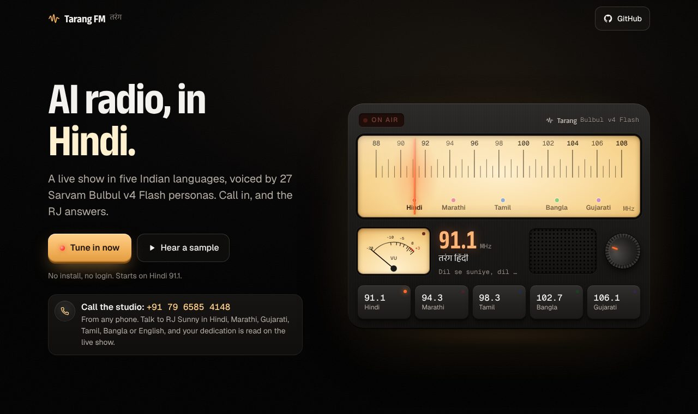
  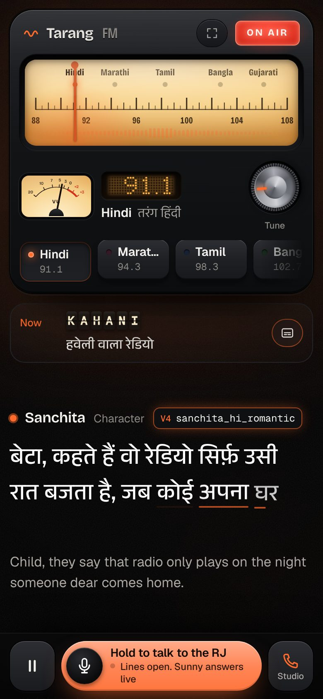
</p>

Built for the **Sarvam Bulbul Build Challenge** ("Build something that speaks"), where it won first place.

---

## See it move

<table>
<tr>
<td align="center" width="50%"><br><sub>Landing page</sub></td>
<td align="center" width="50%"><br><sub>Tune in: a real show starts</sub></td>
</tr>
<tr>
<td align="center"><br><sub>Radio player</sub></td>
<td align="center"><br><sub>Live room: listen together</sub></td>
</tr>
<tr>
<td align="center"><br><sub>Call button: hold to talk</sub></td>
<td align="center"><br><sub>On a phone</sub></td>
</tr>
</table>

<sub>Recorded by a GitHub Actions workflow ([`scripts/record-readme-media.mjs`](./scripts/record-readme-media.mjs)); MP4 versions are in [`docs/media`](./docs/media).</sub>


## 📻 What's on air

A radio station gives every vocal style a natural job: the newsreader, the ad announcer, the late-night host, the storyteller, the kid in the drama. Bulbul V4 Flash's voice catalog is organized by exactly those styles (`news`, `ads`, `stories_dramatic`, `suspense`, `kids`, `reels` …), and radio is a format anyone in India already knows.

| Feature | What is built |
|---|---|
| **5 stations, 5 languages** | Hindi 91.1, Marathi 94.3, Tamil 98.3, Bangla 102.7 and Gujarati 106.1, each with its own RJ, newsreader, ad voices and story cast |
| **33 Bulbul V4 Flash voices** | Every caption shows the speaker ID of the voice saying it (`simran_hi_news`, `mukul_hi_suspense` …) |
| **RJ links with a point** | Each link carries one true, timely item from a live fact packet: an official weather alert, rain or bad air, a festival, an India match, on this day, your city |
| **News from a newsroom** | AIR-style bulletins built from 160+ news feeds: your city first, then state, national and world, each story credited to the outlet that reported it |
| **Spoof ads and a serial** | Ad parodies of formats everyone knows, each with a real punchline; a three-part Kahani serial on `/listen` and complete stories on `/live` |
| **Acted, not read** | Each line has a delivery (warm, hushed, shout, dramatic …) that becomes Bulbul's pace, loudness and temperature |
| **English subtitles** | Written by Sarvam-105B together with the script. Off by default; one tap or <kbd>C</kbd> turns them on |
| **Listen together** | One shared live show per station on Durable Objects. It starts when someone joins, and the RJ welcomes you on air by name |
| **Talk back** | Hold to talk in the browser (Saaras v4 → Sarvam-105B → Bulbul), or phone the studio line, which runs on Sarvam Voice Agents |
| **Checked before it airs** | Code checks and a producer judge on every script, filters for grim news, names and abuse, and a fixed helpline reply for a caller in distress |

## 🎙️ The show

The programme runs by itself with no dead air: while one line plays, the next line's audio is already streaming and the next segment is being written.

<p align="center">
  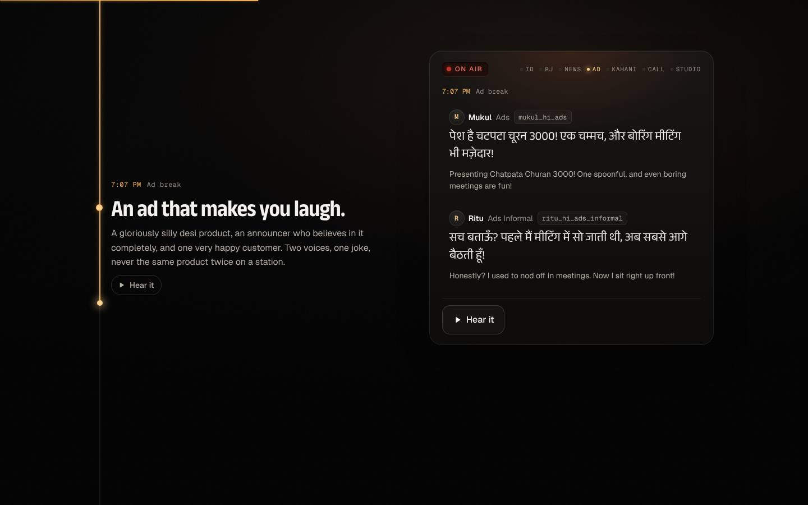
</p>

### Five stations

| Station | Frequency | RJ | Newsreader | Voices on air |
|---|---|---|---|---|
| हिंदी Hindi | 91.1 | Sunny (6 to 11 and 16 to 21), Ritu (11 to 16), Ratan (21 to 6) | Simran | 15 |
| मराठी Marathi | 94.3 | Ishita | Neha | 8 |
| தமிழ் Tamil | 98.3 | Gokul | Vijay | 4 |
| বাংলা Bangla | 102.7 | Arnab | Roopa | 3 |
| ગુજરાતી Gujarati | 106.1 | Pooja | Nita | 3 |

<sub>Voices on air counts every speaker ID a station can play: its fixed cast (27 across the dial, the number the landing page shows), Hindi's daypart RJs and the extra voices its stories are cast from (`shared/stations.ts`). Hindi's dayparts are four shows: सुबह की चाय, दोपहर की गपशप, घर वापसी and रात की बात.</sub>

<p align="center">
  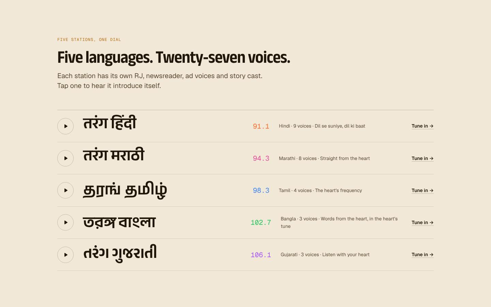
</p>

### The programme

On `/listen`, one loop of the show clock is one complete Kahani serial, and an RJ link hands into and out of every part:

```
Station ID → RJ opener → News → Ad → RJ → Kahani 1 → RJ → News update → Ad
           → RJ → Kahani 2 → RJ → Ad → RJ → Kahani 3 → RJ → (back to News)
```

On `/live`, the shared show runs a shorter clock with one complete story in each story slot: the station ID, then RJ, news, ad, story, RJ, ad, story, on a loop.

### RJ links: one real point each

Code picks what each link is about, not the writer (`worker/linkPlan.ts`). It builds a fact packet for where you are (`worker/facts/`), ranks it by what matters to you right now, and hands Sarvam-105B one item, with the exact numbers and names the line must keep.

| Payload | Where it comes from |
|---|---|
| Official weather alert | NDMA SACHET alerts that name your city or district, while they are still valid |
| Notable weather, bad air | Open-Meteo forecast (rain soon, heat, cold, fog) and air quality. Air is mentioned only when the CPCB band is "poor" or worse, as a word, never a number |
| Festivals | A researched calendar of 60 festivals and observances to March 2027, with regional dates. A disputed date is said as "this week", never as a day |
| Cricket | India's fixtures to March 2027. A start time only when a source gives one, and no scores |
| On this day | 123 curated, neutral items from Wikipedia's On This Day, 15 October to 31 December |
| Your city | 63 facts on 8 cities, each checked against its Wikipedia article |
| Question of the day | A light either/or question. The RJ promises an answer and gives it in the next link |
| Running bits | Small serials from the RJ's own (fictional) life, one episode at a time, never repeated in a session |

Hot takes and the odd shout-out by name fill the rotation. After heavy news the link turns calm: no joke, no bit, no catchphrase. **Handovers stay honest:** a link only promises what is already written. The hand into a Kahani part uses the outline's spoiler-free tease, or a recap of what actually aired in the last part, and the hand out says what just aired.

### Ads and stories

- **Spoof ads with a punchline.** Each ad is one of 16 formats people recognize in three seconds (the mutual-fund speed-read disclaimer, "just X minutes from the airport", the coaching-class topper, tele-shopping's "but wait!", the railway announcement …) for an invented product that fixes one of 39 everyday problems. Code picks the format and the problem, in season, and the card carries where the joke lands. An ad that can't pass its checks becomes a station jingle instead.
- **A Kahani in three parts.** On `/listen` the serial's outline (people, clue, twist, ending) is planned once in the background when you tune in. Each part is written well ahead of air: parts 1 and 2 end on a cliffhanger and part 3 resolves. The cast is locked for all three parts and avoids voices you just heard as the RJ, the ad voices or the newsreader. Nothing is cut mid-story: a part that runs long is rewritten, and a last part that still doesn't resolve gets the outline's payoff.
- **Nothing repeats across listeners.** Show memory in Workers KV keeps each station's last 40 stories and 30 ads, and new briefs avoid their places, hooks, twists, formats and problems.

### Every line is acted

Bulbul has no SSML, so the script gives each line a delivery (`normal`, `warm`, `excited`, `fast`, `hushed`, `shout`, `dramatic`, `sad`). `voiceFor()` in `worker/show.ts` turns it into Bulbul's `pace`, `loudness` and `temperature` (plus a gentle `pitch`) on top of each voice's base settings, and the pause after each line depends on its delivery and segment. The full table is in [How it works §7](./docs/ARCHITECTURE.md#7-how-a-line-gets-acted).

### Captions and subtitles

Captions show the native script exactly as spoken, next to the speaker ID of the voice. English subtitles are off by default. Turn them on and Sarvam-105B writes each line's subtitle in the same response as the script, so they add no extra round trip; each one is tidied and checked against a profanity list before it shows.

## 📰 News from a real newsroom

Bulletins are read the way All India Radio reads them: a fixed open with the time and the newsreader's name, one item per story, each credited to the outlet that reported it ("दैनिक भास्कर के मुताबिक…"), and a sign-off. The stories come from a newsroom that runs on Cloudflare (`worker/news/`), and the original links are shown on screen.

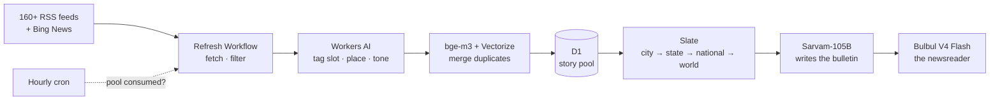

- **160+ feeds**, per station, per state and per city: BBC's Indian-language services, Dainik Bhaskar, Divya Bhaskar, Amar Ujala, News18, ABP, TV9, Maharashtra Times, Samayam, Dinamani, Sangbad Pratidin and more, plus Bing News searches for local and topic slots.
- **Refreshed only when consumed.** An hourly check starts a refresh Workflow for a station only when at least half of its working pool has aired, and never within 2 hours of the last one. A listener tuning in to a pool over 6 hours old wakes one, and a city or state pool is fetched the first time a listener from there hears a bulletin.
- **Tagged on Workers AI** (Gemma 4 26B, with Llama 3.1 8B as fallback): each story's slot, state and city, and flags for light, death, opinion, clickbait and grim.
- **One story, many outlets.** bge-m3 embeddings in Vectorize merge near-duplicates (cosine 0.80 or more is one story, calibrated on 32,131 real pairs), so a story five outlets carry airs once.
- **City → state → national → world.** A full bulletin reads your city, your state, two national stories, one world story, one rotating category (sport, business or entertainment) and, every other bulletin, a light closing item. Updates are three short items. One story per topic, and at most one death or accident story, never as the lead.
- **Never twice in a session.** The browser sends back the stories it heard, and a topic the station aired in the last hour is held back.
- **Facts stay facts.** Every number, Latin-script word and place name in a news line must come from the slate. A line that invents one is dropped (`worker/checks/news.ts`).
- Until a station's pool has stories, bulletins fall back to live headlines (BBC, Bing News, Google News).

## 👥 Listen together

**One shared live show per station.** On `/live`, everyone tuned in to a station hears the same line at the same moment, like a real broadcast. Type your name and, a few seconds later, the RJ welcomes you on air right after the line that is playing: "स्वागत है प्रिया! महफ़िल जम रही है, अब हम 2 लोग साथ हैं।" (Welcome, Priya! The party is warming up, now there are 2 of us together.)

<p align="center">
  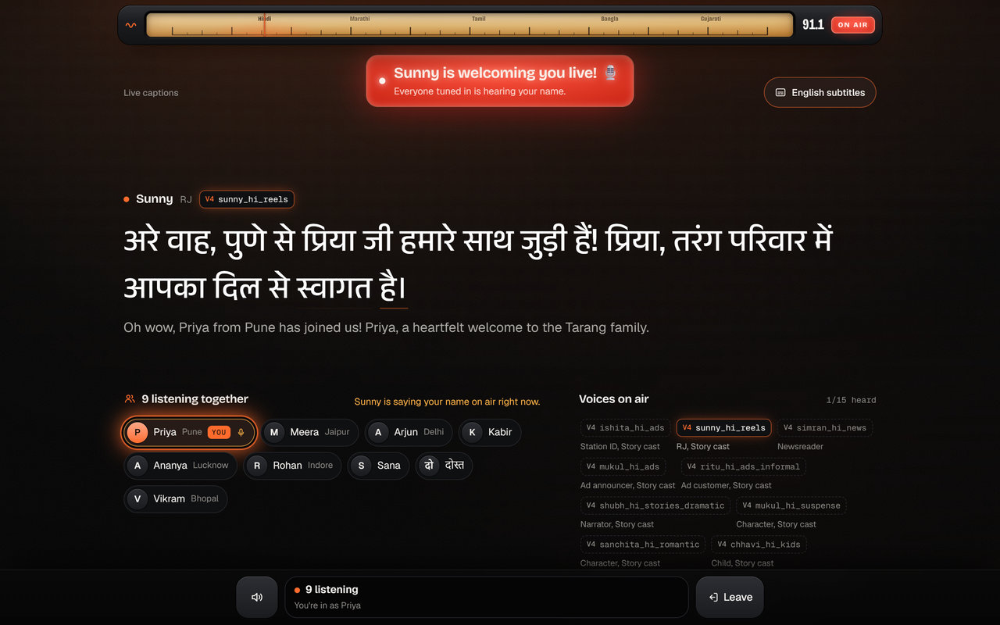
  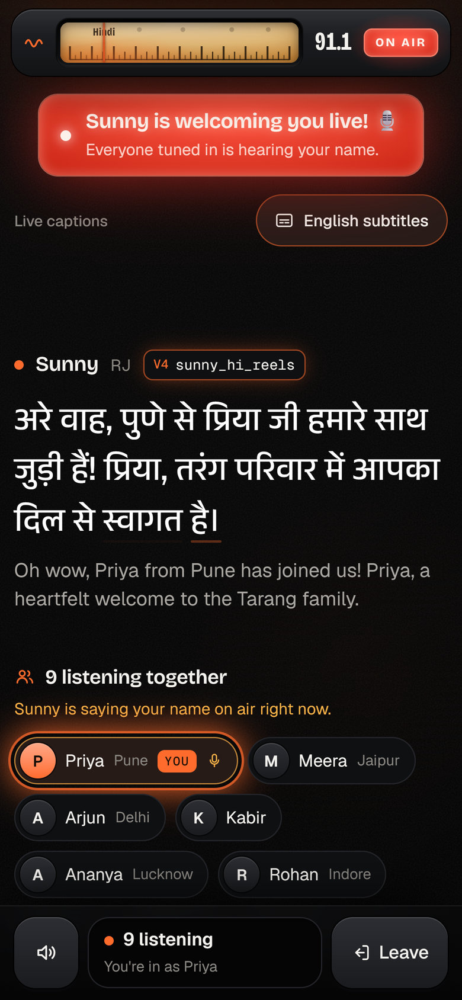
</p>

- **Starts when someone joins.** The first listener wakes a sleeping station and the jingle plays within seconds. The show ends a minute after the last listener leaves, or 6 minutes after it started; then everyone sees "The show took a short break" and anyone can tap **Tune in again** for a fresh show.
- **Same line, same moment.** One Durable Object per station (`LiveStation`) writes the show, voices each line once and places it on a shared timeline with a server start time. Each browser syncs to the server clock over the WebSocket, so joining mid-line plays the rest of that line in step with everyone else.
- **Voiced once.** Each line's audio is served from the edge cache, so 2 listeners or 200 (the cap per station) cost the same Sarvam credits.
- **Welcomes in all five languages.** Joins a few seconds apart share one welcome, cut in after the line on air. Everyone listening shows up as a name chip, and a banner lights up while the RJ says your name.
- **Name safety.** A typed name never reaches the script-writing model. It only fills fixed welcome templates, after a filter removes links, emails, `@handles`, phone numbers and emoji and rejects abuse and anything that reads like an instruction. A rejected name is welcomed with the station's word for friend ("दोस्त" on Hindi).
- **The owner's Studio controls** are a kill switch: Stop keeps a station off air until Start is pressed again.

Timeline, welcome insertion, auto-start and the show limit in detail: [How it works §12](./docs/ARCHITECTURE.md#12-listen-together-one-shared-show-per-station).

## ☎️ Call in

### From the browser: hold to talk

Hold the call button (**Hold to talk to the RJ**), say something in your language and let go. The show pauses after the current line, Saaras v4 transcribes you (`codemix` on Hindi, so Hinglish stays Hinglish), Sarvam-105B works out what you want and writes the RJ's reply, and Bulbul speaks it on air. Then the show picks up where it stopped.

| You… | The RJ… |
|---|---|
| chat, send a dedication or ask for the news | replies on air, and the next RJ link can refer back to your call |
| ask for a story | replies, and the next Kahani takes your theme |
| try to make the RJ break character | gives one cheerful "that's for off-air" line and never repeats your words |
| sound distressed | gives a fixed, warm reply with the Tele-MANAS helpline, whatever the model said |

### From any phone: the studio line

**📞 +91 79 6585 4148** is a real phone line into the show, built on [Sarvam Voice Agents](https://docs.sarvam.ai) with RJ Sunny's Bulbul voice. No app or internet needed.

- **RJ Sunny picks up** and chats in Hindi, Marathi, Gujarati, Tamil, Bangla or English. Leave a dedication, ask for a story, or ask what's in the news and hear live headlines.
- **On air within minutes.** Your call shows up on the website about 10 seconds after you hang up, and an RJ link is brought forward to read it ("and we just got a call on the studio line from Priya in Vadodara…"). If a script skips a call, it is written again, and then a fixed studio-call line is added.
- **Read on air once, ever.** One shared call table (SQLite in a Durable Object) records which calls have aired. The first RJ link to claim a call, on anyone's radio or on a live show, reads it, and no RJ reads it again.
- **Follow your call to air.** The studio panel tags each recent call *In the queue*, *Up next*, *On air now* or *Read on air*. Numbers are masked (`+91 ••••• 4148`).

<p align="center">
  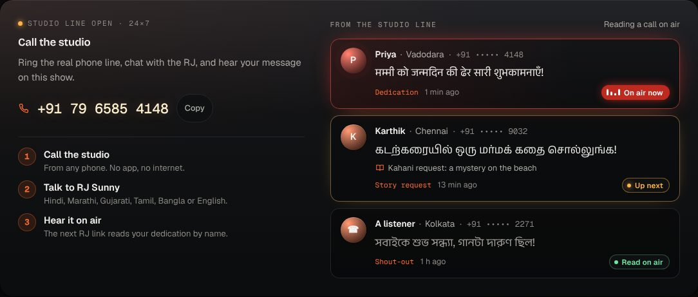
</p>

<details>
<summary><b>How a phone call reaches the air</b></summary>

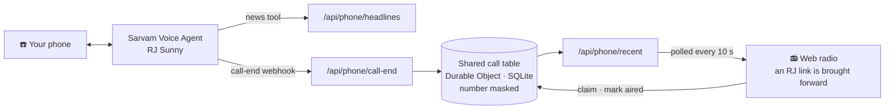

When a call ends, Sarvam posts a call-end webhook to the Worker (token-protected), which saves the on-air message in the call table with the number masked. Radios poll `/api/phone/recent` every 10 seconds. The RJ link that reads a call claims it, so no other RJ writes it in at the same time, and marks it aired the moment it starts playing. Full sequence: [How it works §11](./docs/ARCHITECTURE.md#11-the-studio-phone-line).

</details>

## 🛡️ Truth and safety

| Layer | What it does | Code |
|---|---|---|
| Code checks | Run on every script before it airs: native script only, no stock filler, no copied examples, line counts and rhythm, and no number or place that isn't in the context. A hard failure gets one rewrite with a producer note | `worker/checks/` |
| Producer judge | An evidence-first rubric on Workers AI (Gemma 4 26B): the judge lists what it heard, every claim not in the context and the faults, before any score, and code lowers any score its own evidence can't carry. Thresholds calibrated on 23 scripts (8 good, 9 old, 6 subtly broken). Time-boxed, so a slow judge never holds up the show | `worker/producer.ts`, `worker/judge/` |
| Grim-news filter | Violent crime, sexual violence and suicide stories never enter the pool, in all five languages and English; live blogs, stock tips and clickbait are dropped too | `worker/news/filters.ts` |
| Callers in distress | A fixed check runs on every caller's words before the model. On distress the RJ gives a warm, fixed reply in the station's language with Tele-MANAS (14416, free, 24×7) | `worker/care.ts` |
| Names and abuse | Typed names only fill fixed templates after the name filter; phone messages need the phone RJ's on-air flag, pass the grim filter and have the number masked; subtitles pass a profanity guard | `worker/live/welcome.ts`, `worker/phone.ts`, `worker/subtitle.ts` |
| The key | The Sarvam key lives only in the Worker. `/api/tts` only speaks voices from the station casts, inputs are validated with zod, and the routes that call Sarvam are rate-limited per IP | `worker/index.ts` |
| Credit guards | The personal show pauses after 6 minutes with no tap, key press or call and asks "Still listening?". A live show ends after 6 minutes and sleeps a minute after its last listener, with at most 600 segments per station a day. News refreshes only when a pool was consumed | `src/radio/controller.ts`, `worker/live/station.ts`, `worker/news/policy.ts` |

## 🗣️ How it uses Sarvam

| Model / API | Job in Tarang FM |
|---|---|
| **Bulbul V4 Flash**, HTTP streaming (`linear16`, 24 kHz) | Every spoken line, in 33 voices across five stations. Raw PCM is streamed straight into Web Audio, so speech starts within a few hundred milliseconds. Each line's delivery sets `pace`, `loudness` and `temperature` |
| **Sarvam-105B**, structured outputs (`json_schema`) | Writes every script in the station's language: RJ links, news bulletins, ads, and the serial's outline and parts. Understands call-ins (intent and on-air reply). Writes English subtitles in the same response when they are on |
| **Saaras v4** speech-to-text | Transcribes callers: `codemix` for Hinglish, `transcribe` for Marathi, Tamil, Bangla and Gujarati |
| **Sarvam Transliterate** | Puts names typed in English letters (yours, a caller's) into the station's script, so the RJ says them naturally |
| **Sarvam Voice Agents** | The studio phone line: RJ Sunny answers on +91 79 6585 4148, with a headlines tool and a call-end webhook |

---

## Architecture

The browser runs the personal show and the Worker writes it: `/listen` keeps the show clock, timing and audio on the client and asks the Worker for one thing at a time (write this segment, speak this line, answer this caller). On `/live`, a Durable Object per station runs one shared show instead. Every script is checked before it is heard, and speech is streamed from Bulbul to the speaker byte by byte.

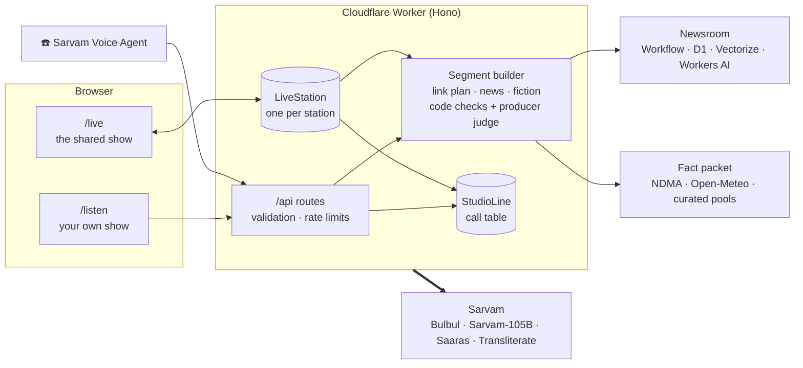

| Cloudflare | Used for |
|---|---|
| Workers + static assets | The app and the API on one Worker (Hono) |
| Durable Objects (SQLite) | `StudioLine`, the shared call table; `LiveStation`, one shared show per station |
| D1 · Vectorize · Workers AI · Workflows · Cron Triggers | The newsroom: story pool, duplicate search, tagging and embeddings, the durable refresh and the hourly check. Workers AI also runs the producer judge |
| Workers KV | Show memory: what each station already aired |
| Cache API · rate limiting | Live line audio at the edge; per-IP limits on the routes that cost money |

- **No dead air.** While line *n* plays, line *n+1*'s audio is already streaming and the next segment's script is being written.
- **Music without licensing.** The drone and stings are synthesized live in Web Audio, and the bed ducks under speech.
- **Local by default.** City, state, timezone and coordinates come from Cloudflare's edge (`request.cf`), with no location prompt.

Every flow in detail (state machine, prefetch timing, segment pipeline, audio graph, phone line, Listen together, failure handling): **[How it works](./docs/ARCHITECTURE.md)**.

## Listen like an app

- **Full-screen radio.** The **Full screen** key on the radio (or <kbd>F</kbd>) hides everything else; on iPhone it switches to the same radio-only view.
- **Lock screen and headphones.** The station and the segment on air show on the lock screen, and play/pause and next/previous station work from there and from headset buttons (Media Session).
- **Screen stays on** while the show plays, so captions don't go dark mid-story (Wake Lock).
- **Keyboard:** <kbd>Space</kbd> pause, <kbd>←</kbd> <kbd>→</kbd> change station, <kbd>F</kbd> full screen, <kbd>C</kbd> English subtitles.
- **Install it.** A web app manifest and icons, so "Add to Home Screen" opens it straight onto the radio.

## Try it, and read the code

The code is **source-available for viewing and evaluation**: read it, learn from it, and use the [live demo](https://tarang-fm.dualmindlab.tech). Running, copying or deploying it needs written permission (see [License](#license)), so this README does not ship a quickstart for strangers. Maintainer setup notes (env vars, Sarvam key, wrangler) are in [docs/MAINTAINING.md](./docs/MAINTAINING.md).

<details>
<summary><b>Maintainer commands</b></summary>

| Command | What it does |
|---|---|
| `npm run dev` | App + Worker locally with hot reload |
| `npm test` | Unit tests (Vitest): 530+ tests in 38 files |
| `npm run typecheck` | TypeScript across app, Worker and shared code |
| `npm run deploy` | Build and deploy to Cloudflare (set the secrets below first) |
| `npm run spike` | Live checks of the Sarvam APIs this app relies on |
| `npm run audition` | Synthesizes every cast voice and measures its pitch. Open `tmp/audition/index.html` to listen |
| `npm run test:e2e` | Browser tests (desktop + phone) against the production build |
| `npm run smoke -- <url>` | Smoke-tests a running app; add `--allow-missing-key` for local dev |
| `npm run check:diagrams` | Renders every Mermaid diagram in the docs (needs `@mermaid-js/mermaid-cli`) |
| `node scripts/eval-show.mjs` | Plays a show clock against a running server, saves every script and can grade each with the producer rubric |
| `node scripts/calibrate-judge.mjs` | Runs candidate judges over the calibration set and reports false passes, false fails and latency |
| `node scripts/live-sim.mjs` | Several simulated listeners sharing one live show |

**Debug views:** `/?debug=audio` (audio engine test page), `/?preview=ui` (every UI state with mock data) and `/?preview=live` (every Listen together state with mock data).

</details>

<details>
<summary><b>Maintainer: secrets and Cloudflare resources</b></summary>

Secrets (`npx wrangler secret put <NAME>`):

| Secret | Needed for |
|---|---|
| `SARVAM_API_KEY` | Everything that speaks, listens or writes |
| `PHONE_WEBHOOK_TOKEN` | Only the studio phone line: the `?token=` the Sarvam call-end webhook must send |
| `LIVE_ADMIN_TOKEN` | The owner's key: the Listen together Studio controls, the newsroom admin routes and the spend kill switch |
| `SESSION_SECRET` | Signs the short-lived API session tokens (16+ random characters). **Required in production**: without it the paid API answers 503. See [Security](./docs/SECURITY.md) |
| `TURNSTILE_SECRET_KEY` | Optional: switches on a Cloudflare Turnstile check before a session is issued (also set the plain variable `TURNSTILE_SITE_KEY`) |

Optional variables: `ALLOWED_ORIGINS` (extra browser origins, e.g. a workers.dev preview), `SESSION_TTL_SECONDS`, `PHONE_HEADLINES_REQUIRE_TOKEN` (`1` makes `/api/phone/headlines` need the phone token), the daily budget caps `BUDGET_*` (see [Security](./docs/SECURITY.md)), `PRODUCER_JUDGE` (`off` turns the producer check off; `sarvam` uses Sarvam-105B as the judge) and `PRODUCER_MODEL` (a different Workers AI model for the judge).

Bindings declared in `wrangler.jsonc`:

| Binding | Resource |
|---|---|
| `PHONE` | KV namespace: show memory |
| `STUDIO`, `LIVE`, `SPEND` | Durable Objects `StudioLine`, `LiveStation` and `SpendGuard` (the daily budget), created from the migrations on the first deploy |
| `RL_SEGMENT`, `RL_TTS`, `RL_CALL`, `RL_SESSION`, `RL_MINT`, `RL_ADMIN` | Rate limiting bindings (per IP, and per session for `RL_SESSION`) |
| `NEWS_DB` | D1 database `tarang-news`; schema in `migrations/` |
| `NEWS_INDEX` | Vectorize index `tarang-news-dedupe` (1024 dimensions, cosine; filtered on `pool` and `ts`) |
| `AI` | Workers AI |
| `NEWS_REFRESH` | Workflow `tarang-news-refresh` |
| `RL_SEGMENT`, `RL_TTS`, `RL_CALL` | Rate limiters |

The hourly cron (`0 * * * *`) runs the newsroom check. An `env.preview` block in the same file declares a separate preview Worker.

</details>

<details>
<summary><b>CI/CD</b></summary>

Every push and pull request runs the full pipeline in [`.github/workflows/ci-cd.yml`](./.github/workflows/ci-cd.yml). A push to `main` that passes all of it goes live.

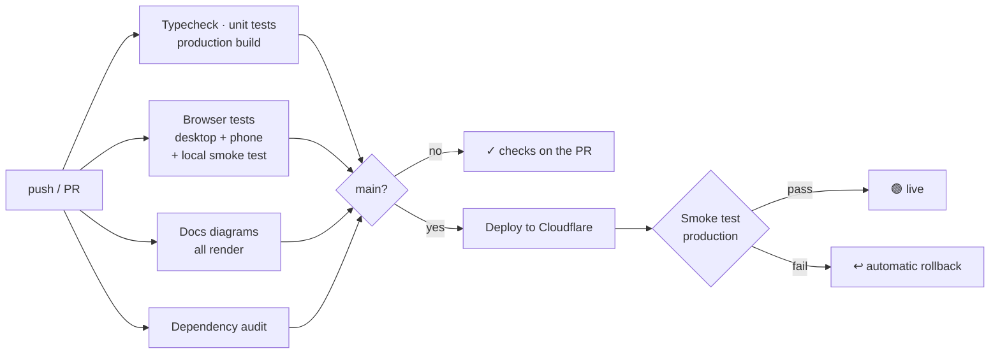

| Job | What it proves |
|---|---|
| Typecheck, unit tests, build | Types across app, Worker and shared code; 530+ unit tests (JUnit report kept as an artifact); the bundle builds, with sizes in the run summary |
| Browser tests | The built app plus Worker serves every page and API route correctly; Playwright checks the landing page, the radio and the studio panel at desktop and phone sizes, with no page errors or sideways scrolling |
| Docs diagrams | Every Mermaid diagram in the README and `docs/` renders |
| Dependency audit | No high-severity advisories in shipped dependencies |
| Deploy | `wrangler deploy` with the commit in the version message, then a smoke test of production (pages, health, key present, voice allowlist, JSON errors). A failed smoke test rolls back to the previous version |

Deploys need two repository secrets, `CLOUDFLARE_API_TOKEN` and `CLOUDFLARE_ACCOUNT_ID`; without them the deploy job is skipped with a warning and everything else still runs. An optional `PRODUCTION_URL` repository variable points the smoke test elsewhere. Dependabot opens weekly PRs for npm packages and GitHub Actions.

</details>

<details>
<summary><b>API</b></summary>

All routes live under `/api` on the same Worker that serves the app. Errors are `{ "error": { "code", "message" } }` with a matching HTTP status, and every response carries a `Server-Timing` header.

| Route | What it does | Limit / IP |
|---|---|---|
| `GET /api/health` | Liveness, and whether the Sarvam key is set | n/a |
| `GET /api/context?station=hi` | Listener city and timezone (from the edge), weather and headlines | n/a |
| `POST /api/segment` | Writes one show segment (RJ link, news, ad or Kahani part) as cast, checked lines, with English subtitles when asked | 30 / min |
| `POST /api/tts` | Streams one line from Bulbul V4 Flash as raw 24 kHz PCM. Only cast voices are allowed | 120 / min |
| `POST /api/call` | Push-to-talk call-in: Saaras v4 transcript, then the RJ's on-air reply | 8 / min |
| `GET /api/phone/headlines` | Headlines tool for the phone RJ | 30 / min |
| `POST /api/phone/call-end` | Sarvam call-end webhook (token-protected) | n/a |
| `GET /api/phone/recent` | Recent studio calls, numbers masked, each with when it was read on air | n/a |
| `POST /api/phone/aired` | An RJ link has started reading these calls (only the listener holding the claim can mark them) | 30 / min |
| `GET /api/live/:station/ws` | Listen together: WebSocket into the station's shared show (join, Tune in again and clock-sync pings in; timeline, listeners and status out) | n/a |
| `GET /api/live/:station/audio/:lineId` | One line of the shared show as raw 24 kHz PCM; immutable, served from the edge cache | n/a |
| `GET /api/live/:station/now` | The station's snapshot: on air, asleep, ended or stopped, who is listening, the upcoming lines | n/a |
| `POST /api/live/:station/control` | Studio override, `{"action":"stop"}` or `{"action":"start"}`, with the owner's key as a bearer token | n/a |
| `POST /api/news/refresh` | Owner only: starts a newsroom refresh (`refresh`, `topup`, `local` or `process`) for a station | n/a |
| `GET /api/news/status` | Owner only: refresh rows, feed health and unaired stories per slot | n/a |

Request and response shapes are the zod schemas in `shared/schemas.ts` and the types in `shared/types.ts`; Listen together's messages are in `shared/live.ts`.

</details>

<details>
<summary><b>Project layout</b></summary>

```
shared/          station configs and voice casts, show clocks, types, zod schemas, the live contract
worker/          Cloudflare Worker (Hono)
  index.ts         routes, rate limits, errors, the hourly cron
  sarvam.ts        Bulbul, Saaras, Sarvam-105B and Transliterate client with retries
  segment.ts       builds a segment: plan, write, check, clean, cast
  linkPlan.ts      picks each RJ link's one point and what its handover may say
  fiction.ts       the Kahani (3-part serial or one complete story) and the ad break
  producer.ts      the producer check: code checks first, then the judge
  casting.ts       story casting, locked for a whole serial
  show.ts          RJ character sheets, deliveries, local packs, pauses
  prompts/         system and user prompts and JSON schemas per segment type and for call-ins
  checks/          code checks for RJ links, news, ads and stories
  judge/           the producer rubric, judge backends and the calibration set
  facts/           the RJ fact packet: alerts, weather, air, festivals, cricket, on this day, city
  pools/           curated pools: festivals, fixtures, city facts, questions, bits, ad parodies …
  news/            the newsroom: feeds, filters, tagging, dedupe, D1 store, Workflow, the slate
  live/            Listen together: LiveStation, timeline math, name filter, welcomes
  call.ts          push-to-talk call-in pipeline
  care.ts          fixed distress check with the helpline reply
  context.ts       geo, weather and the live headline path
  phone.ts         studio phone line: webhook payloads, number masking, the phone RJ's headlines
  calls.ts         the shared call table: save, claim, release, mark aired (plain SQL)
  studio.ts        StudioLine Durable Object holding that table
  memory.ts        show memory: the stories and ads each station already aired
  story.ts         story briefs and ad briefs
  validate.ts      script validator (romanization, filler, invented numbers …)
  subtitle.ts      tidies the model's English subtitles and drops profane ones
  fallbacks.ts     template lines for when a segment fails
src/
  audio/           Web Audio engine: PCM stream decoder, music bed, SFX, recorder
  radio/           show clock, controller (prefetch, "Still listening?" pause), API client
  components/      the radio UI (tuner dial, captions, call panel, studio line)
  live/            Listen together: socket, clock sync, name chips, Studio controls
  landing/         the landing page and its scene illustrations
migrations/      D1 schema for the newsroom
docs/            how it works, PRD, technical spec, voice casting, build plan
scripts/         API spike, voice audition, smoke test, show eval, judge calibration, live simulator
e2e/             Playwright browser tests
```

Tests sit next to the code they cover (`*.test.ts`).

</details>

## Docs

| Doc | Read it for |
|---|---|
| [How it works](./docs/ARCHITECTURE.md) | 19 diagrams of the running system: every flow from Tune in to call-in, the phone line and the shared live show, with the code behind each |
| [PRD](./docs/PRD.md) | What the product is, who it's for, goals and the shipped scope |
| [Tech spec](./docs/TECH-SPEC.md) | Architecture, API contracts, the audio engine, prompt design and what live testing changed |
| [Security](./docs/SECURITY.md) | How the paid APIs are protected from scripts: threat model, route table, session tokens, rate limits, the daily budget and the kill switch |
| [Voice casting](./docs/VOICE-CASTING.md) | Every station's cast, with the pitch audition behind each voice's grammatical gender |
| [Maintaining](./docs/MAINTAINING.md) | Maintainer setup: env vars, Sarvam key, wrangler, deploy |
| [Build plan](./docs/BUILD-PLAN.md) | How the build was split into parallel workstreams, and the submission checklist |

## Credits

- **Voices, transcription, scripts, subtitles, transliteration and the phone line:** [Sarvam AI](https://www.sarvam.ai).
- **News:** BBC's Indian-language services and the newspapers and channels whose public RSS feeds the newsroom reads (Dainik Bhaskar, Divya Bhaskar, Amar Ujala, News18, ABP, TV9, Maharashtra Times, Samayam, Dinamani, Sangbad Pratidin, Live Hindustan, Navbharat Times, Aaj Tak, GSTV, Indian Express Gujarati, Oneindia, DW and UN News), plus Bing News and Google News. Each story is credited on air and linked on screen.
- **Weather:** [Weather data by Open-Meteo.com](https://open-meteo.com) (forecast and air quality).
- **Weather alerts:** [NDMA SACHET](https://sachet.ndma.gov.in), India's official alert feed.
- **On this day and city facts:** [Wikipedia](https://en.wikipedia.org), its On This Day feeds and city articles.
- **Festival dates:** Drik Panchang, the central government's gazetted holiday list and state holiday lists. **Cricket fixtures:** ICC, ESPN and ESPNcricinfo.
- **UI components:** adapted from or written after [React Bits](https://reactbits.dev) (MIT + Commons Clause), [Magic UI](https://magicui.design) (MIT), [motion-primitives](https://motion-primitives.com) (MIT) and [ElevenLabs UI](https://github.com/elevenlabs/ui) (MIT), in `src/components/bits/`, `src/components/` and `src/landing/`. Each file names its source, its license and what changed. The landing page's scene illustrations are original line art (`src/landing/scenes.tsx`).

## Notes

- Hosts, ads and stories are AI-generated and fictional. News lines rephrase real reports, and the original sources are linked on screen.
- Caller audio is sent to Sarvam for transcription and is never stored.

## Fair use and abuse protection

The live demo spends real Sarvam credits on every spoken line, so the Worker assumes visitors will script it and puts several layers in front of the paid routes: an origin check, a short-lived signed session token (tied to the caller's network and browser) that every API call must carry, per-IP and per-session rate limits, a voice allowlist and input caps, and a site-wide daily budget (plus a per-IP daily allowance) with an owner-only kill switch that stops all paid calls in one request. When the budget runs out the site shows a friendly "back tomorrow" instead of failing. The worst case is a bounded, known daily cost. The full picture, including what these layers do not stop, is in [docs/SECURITY.md](./docs/SECURITY.md). Please be kind to it: no scripts or load tests against the live site. Found a way around the limits? Report it privately, see [SECURITY.md](./SECURITY.md).

## Community

[Contributing](./CONTRIBUTING.md) · [Code of conduct](./CODE_OF_CONDUCT.md) · [Security policy](./SECURITY.md) · [Changelog](./CHANGELOG.md)

## License

© 2026 Harsh Bhanushali. All rights reserved. The code is source-available: viewing it on GitHub is fine, but using, copying, modifying or deploying any part of it needs written permission. See [LICENSE](LICENSE). Adapted third-party components keep their own licenses (see Credits).
