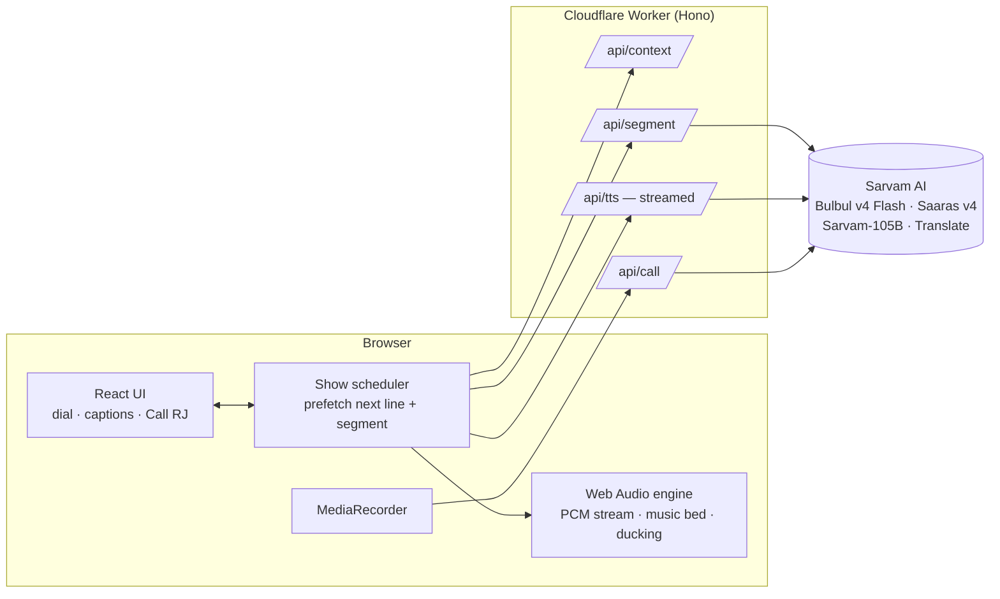

# तरंग Tarang FM

**An AI radio station in your language.** Open the link, press **Tune in**, and a live show starts playing: a jingle, an RJ who greets you by name, today's headlines, a ridiculous ad break and a short radio drama with a full voice cast. **Hold "Call RJ"**, say something in your language, and the RJ answers you on air.

Every voice is [Sarvam **Bulbul v4 Flash**](https://docs.sarvam.ai/api/api-guides-tutorials/text-to-speech/best-practice-guide-for-bulbul-v-4-flash). Each line on screen shows exactly which of its personas is speaking.

**▶ Live:** https://tarang-fm.creharsh.workers.dev (the landing page, with a playable gallery of all 16 voices) · **Straight to the radio:** https://tarang-fm.creharsh.workers.dev/listen · Works on any phone or laptop, with no install or login.

> 🎬 Demo video: _coming with the submission_

Built for the **Sarvam Bulbul Build Challenge**: "Build something that speaks".

---

## Why a radio station?

Every segment of a real radio station has its own vocal style: the newsreader, the ad guy, the late-night host, the storyteller, the kid in the drama. Bulbul v4 Flash's catalog of 224 voices is organized by exactly those styles (`news_breaking`, `ads`, `stories_dramatic`, `suspense`, `kids`, `reels` …). A station lets all of them play their natural part in one familiar format that anyone in India already understands.

## What you hear

| Segment | What happens | Voices (Hindi station) |
|---|---|---|
| 📻 Station ID | Spoken jingle over a synthesized sting | `ishita_hi_ads` |
| 🎙️ RJ link | Greets you by name and city, mentions your local weather and the time of day, teases what's next | `sunny_hi_reels` |
| 📰 News | Opens with real stories **from your own city**, then national headlines, in your language and rephrased for radio (sources shown) | `simran_hi_news_breaking` |
| 📢 Ad break | A fictional, absurd desi product. Announcer plus customer | `mukul_hi_ads`, `ritu_hi_ads_informal` |
| 👻 Kahani Corner | A 60–90 s radio drama with narrator, characters and a twist | `shubh_hi_stories_dramatic`, `mukul_hi_suspense`, `sanchita_hi_romantic`, `chhavi_hi_kids` |
| ☎️ Call-in | Push to talk. The RJ replies live, and a story request changes the next Kahani | the station's RJ |

**Stations:** Hindi (91.1), Tamil (98.3) and Bangla (102.7), each cast with native v4 voices: 16 distinct personas across the dial. Captions show the native script with an English subtitle underneath, so anyone can follow any station.

## Call the studio

**📞 +91 79658 54148** is a real phone line into the show. Call it from any phone, no app or internet needed.

- **RJ Sunny picks up** and chats with you in Hindi, Marathi, Gujarati, Tamil, Bangla or English. Leave a dedication, ask for a story or ask what's in the news (the RJ reads you live headlines).
- **Your message goes on air.** When you hang up, the next RJ link on the web show reads your dedication out by first name and city ("and we just got a call on the studio line from Priya in Vadodara…"). The radio also lists recent calls under **From the studio line**.
- **How it works:** the line runs on [Sarvam Voice Agents](https://docs.sarvam.ai) with the Bulbul v4 Sunny voice. When a call ends, Sarvam posts a call-end webhook to the Worker (`/api/phone/call-end`, token-protected), which keeps the on-air message in Cloudflare KV with the caller's number masked (`+91 ••••• 4148`). Listeners' radios poll `/api/phone/recent` and hand each new call to the RJ exactly once.

## How it uses Sarvam

| Model / API | Job in Tarang FM |
|---|---|
| **Bulbul v4 Flash**, HTTP streaming (`linear16`, 24 kHz) | Every spoken line. Raw PCM is streamed straight into Web Audio, so speech starts in a few hundred ms. Delivery is shaped by persona choice, `pace` and `temperature` |
| **Sarvam-105B**, structured outputs (`json_schema`) | Writes every script (RJ links, news, ads, dramas) in the station's language with a per-role cast sheet, and understands call-ins (intent + on-air reply) |
| **Saaras v4** speech-to-text | Transcribes callers (`codemix` for Hinglish, `transcribe` for Tamil and Bangla) |
| **Sarvam Translate** (`mayura:v1`) | English subtitles under every caption |
| **Sarvam Voice Agents** | The studio phone line: RJ Sunny (Bulbul v4) answers calls on +91 79658 54148, with a headlines tool and a call-end webhook |

## Architecture



- **No dead air.** While line *n* plays, line *n+1*'s audio is already streaming, and the next segment's script is being written.
- **The API key never reaches the browser.** All Sarvam calls go through the Worker, with per-IP rate limits (Cloudflare rate-limiting bindings).
- **Music without copyright issues.** The drone and stings are synthesized live in Web Audio, and the bed ducks automatically under speech.
- **Local by default:** the listener's city, timezone and coordinates come from Cloudflare's edge (`request.cf`), with no location prompt. City news comes from Bing News search, national news from BBC's service in the station language (Google News as a fallback), and the weather from Open-Meteo. Grim crime stories are filtered out.

## Run it locally

Needs Node 22+ and a Sarvam API key from [dashboard.sarvam.ai](https://dashboard.sarvam.ai).

```bash
git clone https://github.com/harshbhx/tarang-fm.git
cd tarang-fm
npm install
echo "SARVAM_API_KEY=your_key_here" > .dev.vars
npm run dev            # http://localhost:5173
```

| Command | What it does |
|---|---|
| `npm run dev` | App + Worker locally with hot reload |
| `npm test` | Unit tests (Vitest) |
| `npm run deploy` | Build and deploy to Cloudflare (`npx wrangler secret put SARVAM_API_KEY` first) |
| `npm run spike` | Live checks of the Sarvam APIs this app relies on |
| `npm run audition` | Synthesizes every cast voice and measures its pitch. Open `tmp/audition/index.html` to listen |

## Project layout

```
shared/   station configs + voice casts, types, zod schemas (used by both sides)
worker/   Cloudflare Worker: Sarvam client, prompts, context, routes
src/
  audio/       Web Audio engine: PCM stream decoder, music bed, SFX, recorder
  radio/       show scheduler, API client, state store
  components/  the radio UI (tuner dial, captions, call button)
  landing/     the landing page and voice gallery
docs/     PRD, technical spec, voice casting, build plan
scripts/  API spike and voice audition tools
```

The full design is in [`docs/`](./docs): [PRD](./docs/PRD.md) · [Tech spec](./docs/TECH-SPEC.md) · [Voice casting](./docs/VOICE-CASTING.md).

## Notes

- Hosts, ads and stories are AI-generated and fictional. News lines rephrase real headlines, and the original sources are linked on screen.
- Caller audio is sent to Sarvam for transcription and is never stored.
- Headlines via BBC, Bing News and Google News. Weather by [Open-Meteo](https://open-meteo.com). Voices, transcription, translation and scripts by [Sarvam AI](https://www.sarvam.ai).
