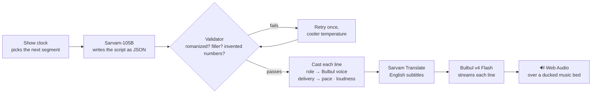
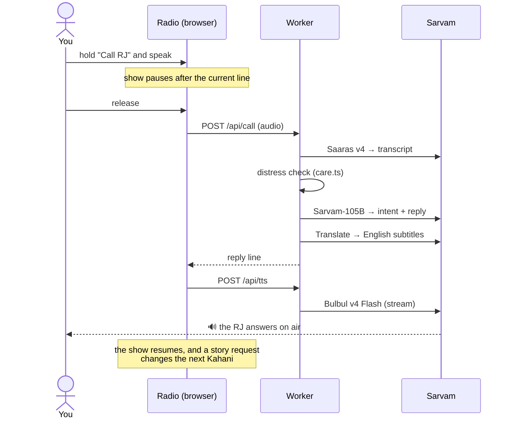
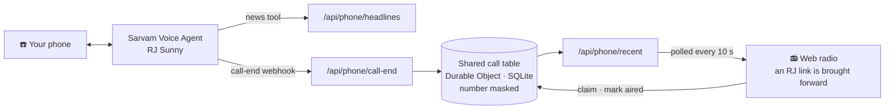
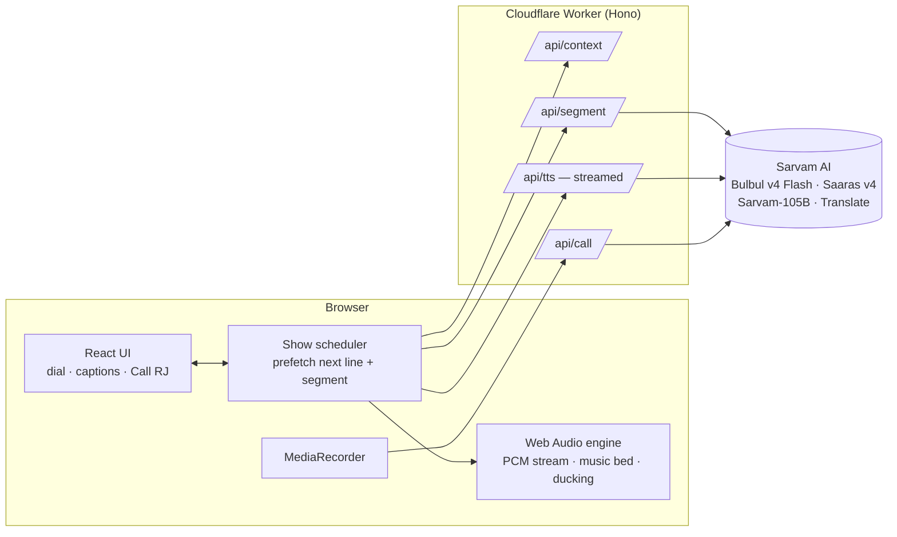
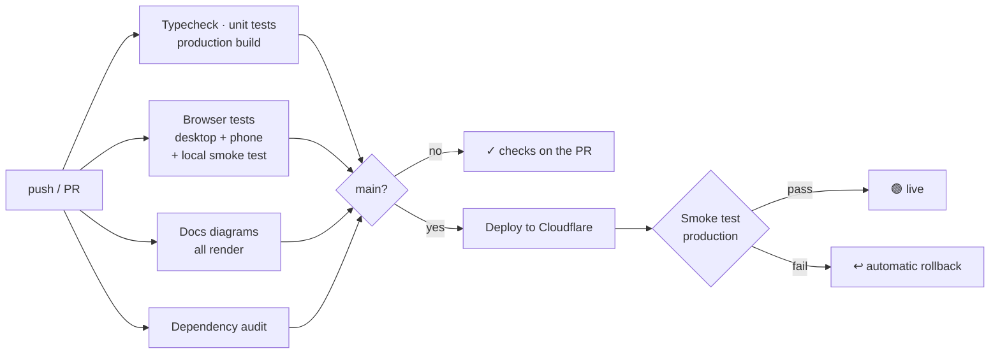

# तरंग Tarang FM

[](https://github.com/harshbhx/tarang-fm/actions/workflows/ci-cd.yml)

**An AI radio station in your language.** Open the link, press **Tune in**, and a live show starts playing: a jingle, an RJ who greets you by name, today's headlines, a ridiculous ad break and a short radio drama with a full voice cast. **Hold "Call RJ"**, say something in your language, and the RJ answers you on air.

Every voice is [Sarvam **Bulbul v4 Flash**](https://docs.sarvam.ai/api/api-guides-tutorials/text-to-speech/best-practice-guide-for-bulbul-v-4-flash). Each line on screen shows exactly which of its personas is speaking.

**▶ Live:** https://tarang-fm.dualmindlab.tech (the landing page, with a playable voice gallery for all five stations) · **Straight to the radio:** https://tarang-fm.dualmindlab.tech/listen · Works on any phone or laptop, with no install or login.

> 🎬 Demo video: _recording in progress; the shot list is in [docs/BUILD-PLAN.md §6](./docs/BUILD-PLAN.md#6-demo-video-7590-s-shot-list)_

<p align="center">
  
  
</p>
<p align="center">
  
</p>
<p align="center"><sub>Screens from the app's UI preview mode, with sample captions and calls.</sub></p>

Built for the **Sarvam Bulbul Build Challenge**: "Build something that speaks".

---

## Why a radio station?

Every segment of a real radio station has its own vocal style: the newsreader, the ad guy, the late-night host, the storyteller, the kid in the drama. Bulbul v4 Flash's catalog of 224 voices is organized by exactly those styles (`news_breaking`, `ads`, `stories_dramatic`, `suspense`, `kids`, `reels` …). A station lets all of them play their natural part in one familiar format that anyone in India already understands.

## What you hear

| Segment | What happens | Voices (Hindi station) |
|---|---|---|
| 📻 Station ID | Spoken jingle over a synthesized sting | `ishita_hi_ads` |
| 🎙️ RJ link | Greets you by name and city, mentions your local weather and the time of day, teases what's next | `sunny_hi_reels`, `ritu_hi_social_lively`, `ratan_hi_latenight_warm` (by time of day) |
| 📰 News | Opens with real stories **from your own city**, then national headlines, in your language and rephrased for radio (sources shown) | `simran_hi_news` |
| 📢 Ad break | A fictional, absurd desi product. Announcer plus customer | `mukul_hi_ads`, `ritu_hi_ads_informal` |
| 👻 Kahani Corner | A 60–90 s radio drama with narrator, characters and a twist | `shubh_hi_stories_dramatic`, `mukul_hi_suspense`, `sanchita_hi_romantic`, `chhavi_hi_kids` |
| ☎️ Call-in | Push to talk. The RJ replies live, and a story request changes the next Kahani | the station's RJ |

**Stations:** Hindi (91.1), Marathi (94.3), Tamil (98.3), Bangla (102.7) and Gujarati (106.1), each cast with native v4 voices: 29 distinct personas across the dial. Captions show the native script with an English subtitle underneath, so anyone can follow any station.

## How the show is written



- **RJs with a character.** Each station's RJ has a character sheet (age, background, how they joke), a catchphrase and a set of running bits (`worker/show.ts`). The catchphrase only comes out when the mood is light. After heavy news there are no jokes, just one calm line.
- **Daypart shows on Hindi 91.1.** सुबह की चाय (6 to 11, RJ Sunny), दोपहर की गपशप (11 to 16, RJ Ritu), घर वापसी (16 to 21, RJ Sunny) and रात की बात (21 to 6, RJ Ratan), each with its own voice and character sheet (`shared/stations.ts`).
- **Every line is acted.** The script gives each line a delivery (`normal`, `warm`, `excited`, `fast`, `hushed`, `shout`, `dramatic`, `sad`). Bulbul has no SSML, so each delivery maps to `pace`, `loudness` and `temperature` on top of the voice's base settings (`DELIVERY_PARAMS`).
- **Natural pauses.** The gap after each line depends on its delivery and segment: steady in the news, tighter in ads, longer in the Kahani, with a little random variation so it never sounds metronomic.
- **Local flavour.** For known cities the RJ gets a local pack (`LOCAL_PACKS`): the city's own greeting, landmarks, food and vibe, such as "केम छो बड़ौदा" and Sursagar lake for Vadodara.
- **Stories that drop you straight in.** Every Kahani is built from a fresh brief (a place, a hook, a twist, regional names) and opens one of six ways: a character mid-trouble, one sharp image, a quiet question, an overheard argument, a note read aloud, or the ending first. The title is woven in, never announced; "आज की कहानी…" and "Kahani Corner presents" are banned, and the RJ's hand-over into the story changes every time.
- **A different cast every story.** Each story is cast from the station's pool of verified Bulbul voices: a narrator who suits the genre (a late-night voice for ghost stories), two characters who can be any mix of women and men, and a kid. On Hindi that's 15 voices; no voice plays two parts.
- **Your name, sparingly.** The RJ greets you by name on the first link and then about every 40 minutes, once per greeting. Ads, news and stories never use it, call-in replies use it once, and the server removes any extra the model slips in.
- **Nothing repeats, for anyone.** The show memory (`worker/memory.ts`) keeps each station's last 40 stories and 30 ads in Workers KV. New briefs avoid the places, hooks, twists, openings, ad categories and formats used recently, the prompt lists what already aired, and a story or ad whose title already aired is rewritten.
- **Script checks.** A validator (`worker/validate.ts`) rejects romanized Hindi, stock filler phrases, lines copied from the prompt's examples, overlong lines and any number in the news that isn't in the real headlines. A failed script is retried once at a lower temperature (`worker/segment.ts`). After that, news lines that still carry an invented number are dropped.

## Listen like an app

- **Full-screen radio.** While a show plays, the radio, the programme strip and the live caption fill exactly one screen above the controls. The **Full screen** key on the radio (or <kbd>F</kbd>) goes properly full screen and hides everything else; on iPhone it switches to the same radio-only view.
- **Lock screen and headphones.** The station and the segment on air show on the lock screen and in the notification shade. Play/pause and next/previous station work from there and from headset buttons (Media Session).
- **Screen stays on** while the show plays, so captions don't go dark mid-story (Wake Lock).
- **Keyboard:** <kbd>Space</kbd> pause, <kbd>←</kbd> <kbd>→</kbd> change station, <kbd>F</kbd> full screen, <kbd>C</kbd> English subtitles.
- **Install it.** Tarang FM has a web app manifest and icons, so "Add to Home Screen" or "Install app" opens it straight onto the radio, without browser bars.

## Call the RJ from the browser



## Call the studio

**📞 +91 79 6585 4148** is a real phone line into the show. Call it from any phone, no app or internet needed.

- **RJ Sunny picks up** and chats with you in Hindi, Marathi, Gujarati, Tamil, Bangla or English. Leave a dedication, ask for a story or ask what's in the news (the RJ reads you live headlines).
- **Your message goes on air, within minutes.** Your call shows up on the website about 10 seconds after you hang up, and an RJ link is brought forward to read it ("and we just got a call on the studio line from Priya in Vadodara…"). Every call is guaranteed a read: if the script skips one, the Worker retries and then adds a fixed studio-call line. A story request also sets the theme of the next Kahani.
- **Read once, ever.** One shared call table (SQLite in a Durable Object) records which calls have aired. Once any listener's RJ reads a call, no RJ reads it again: not after a rejoin, not on another device, not for another listener.
- **Follow your call to air.** The **Call the studio** panel lists recent calls, each tagged *In the queue*, *Up next*, *On air now* or *Read on air*.


- **How it works:** the line runs on [Sarvam Voice Agents](https://docs.sarvam.ai) with the Bulbul v4 Sunny voice. When a call ends, Sarvam posts a call-end webhook to the Worker (`/api/phone/call-end`, token-protected), which saves the on-air message in the studio line's call table (a SQLite Durable Object) with the caller's number masked (`+91 ••••• 4148`). Listeners' radios poll `/api/phone/recent` every 10 seconds. The RJ link that reads a call claims it, so no other listener's RJ writes it in at the same time, and marks it aired the moment it starts playing.

## How it uses Sarvam

| Model / API | Job in Tarang FM |
|---|---|
| **Bulbul v4 Flash**, HTTP streaming (`linear16`, 24 kHz) | Every spoken line. Raw PCM is streamed straight into Web Audio, so speech starts in a few hundred ms. Delivery is shaped by persona choice, `pace`, `loudness` and `temperature` |
| **Sarvam-105B**, structured outputs (`json_schema`) | Writes every script (RJ links, news, ads, dramas) in the station's language with a per-role cast sheet, and understands call-ins (intent + on-air reply) |
| **Saaras v4** speech-to-text | Transcribes callers (`codemix` for Hinglish, `transcribe` for Marathi, Tamil, Bangla and Gujarati) |
| **Sarvam Translate** (`mayura:v1`) | English subtitles under every caption |
| **Sarvam Voice Agents** | The studio phone line: RJ Sunny (Bulbul v4) answers calls on +91 79 6585 4148, with a headlines tool and a call-end webhook |

## Architecture



- **No dead air.** While line *n* plays, line *n+1*'s audio is already streaming, and the next segment's script is being written.
- **The API key never reaches the browser.** All Sarvam calls go through the Worker, with per-IP rate limits (Cloudflare rate-limiting bindings).
- **Music without copyright issues.** The drone and stings are synthesized live in Web Audio, and the bed ducks automatically under speech.
- **Local by default:** the listener's city, timezone and coordinates come from Cloudflare's edge (`request.cf`), with no location prompt. City news comes from Bing News search, national news from BBC's service in the station language (Google News as a fallback), and the weather from Open-Meteo. Grim crime stories are filtered out.

For every flow in detail (state machine, prefetch timing, segment pipeline, audio graph, failure handling) see **[How it works](./docs/ARCHITECTURE.md)**.

## Safety

- **Grim news stays off air.** Headlines about murder, sexual violence or suicide are filtered out before the news is written.
- **A fixed safety net on call-ins.** A deterministic check (`worker/care.ts`) runs on every caller's words, in all five station languages and English. If a caller sounds distressed, the RJ always gives a warm, fixed reply in the station's language with the Tele-MANAS helpline (14416, free, 24×7), whatever the model decided.
- **Clean subtitles.** Machine translation occasionally turns a harmless line into an English swear word. Any subtitle that trips a profanity list (`worker/subtitle.ts`) is dropped, and the native-script caption still shows.
- **Prompt injection gets deflected.** Callers who try to make the RJ break character, ignore its rules or say something unsafe get one cheerful "that's for off-air" line, and their words are never repeated on air.
- **The key stays on the server.** All Sarvam calls go through the Worker. `/api/tts` only accepts voices from the station casts, inputs are validated, and the routes that call Sarvam are rate-limited per IP.

## Run it locally

Needs Node 22+ and a Sarvam API key from [dashboard.sarvam.ai](https://dashboard.sarvam.ai).

```bash
git clone https://github.com/harshbhx/tarang-fm.git
cd tarang-fm
npm install
echo "SARVAM_API_KEY=your_key_here" > .dev.vars
npm run dev            # http://localhost:5173
```

| Command | What it does |
|---|---|
| `npm run dev` | App + Worker locally with hot reload |
| `npm test` | Unit tests (Vitest) |
| `npm run typecheck` | TypeScript across app, Worker and shared code |
| `npm run deploy` | Build and deploy to Cloudflare (set the secrets below first) |
| `npm run spike` | Live checks of the Sarvam APIs this app relies on |
| `npm run audition` | Synthesizes every cast voice and measures its pitch. Open `tmp/audition/index.html` to listen |
| `npm run test:e2e` | Browser tests (desktop + phone) against the production build |
| `npm run smoke -- <url>` | Smoke-tests a running app; add `--allow-missing-key` for local dev |
| `npm run check:diagrams` | Renders every Mermaid diagram in the docs (needs `@mermaid-js/mermaid-cli`) |

**Secrets for a deploy** (`npx wrangler secret put <NAME>`):

| Secret | Needed for |
|---|---|
| `SARVAM_API_KEY` | Everything that speaks, listens or writes |
| `PHONE_WEBHOOK_TOKEN` | Only the studio phone line: the `?token=` the Sarvam call-end webhook must send |

The phone line also uses the `PHONE` KV namespace declared in `wrangler.jsonc`. Create your own with `npx wrangler kv namespace create PHONE` and put its id there.

**Debug views:** `/?debug=audio` (audio engine test page) and `/?preview=ui` (every UI state with mock data).

## CI/CD

Every push and pull request runs the full pipeline in [`.github/workflows/ci-cd.yml`](./.github/workflows/ci-cd.yml). A push to `main` that passes all of it goes live.



| Job | What it proves |
|---|---|
| Typecheck, unit tests, build | Types across app, Worker and shared code; 135+ unit tests (JUnit report kept as an artifact); the bundle builds, with sizes in the run summary |
| Browser tests | The built app plus Worker serves every page and API route correctly; Playwright checks the landing page, the radio and the studio panel at desktop and phone sizes, with no page errors or sideways scrolling |
| Docs diagrams | Every Mermaid diagram in the README and `docs/` renders |
| Dependency audit | No high-severity advisories in shipped dependencies |
| Deploy | `wrangler deploy` with the commit in the version message, then a smoke test of production (pages, health, key present, voice allowlist, JSON errors). A failed smoke test rolls back to the previous version |

**To turn on deploys**, add two repository secrets (Settings → Secrets and variables → Actions):

| Secret | Value |
|---|---|
| `CLOUDFLARE_API_TOKEN` | A Cloudflare API token with the "Edit Cloudflare Workers" template |
| `CLOUDFLARE_ACCOUNT_ID` | Your Cloudflare account ID |

Without them the deploy job is skipped with a warning and everything else still runs. Optionally set a `PRODUCTION_URL` repository variable if the site moves. Dependabot opens weekly PRs for npm packages and GitHub Actions.

## API

All routes live under `/api` on the same Worker that serves the app. Errors are `{ "error": { "code", "message" } }` with a matching HTTP status, and every response carries a `Server-Timing` header.

| Route | What it does | Limit / IP |
|---|---|---|
| `GET /api/health` | Liveness, and whether the Sarvam key is set | n/a |
| `GET /api/context?station=hi` | Listener city and timezone (from the edge), weather and headlines | n/a |
| `POST /api/segment` | Writes one show segment (RJ link, news, ad or Kahani) as cast, cleaned, subtitled lines | 30 / min |
| `POST /api/tts` | Streams one line from Bulbul v4 Flash as raw 24 kHz PCM. Only cast voices are allowed | 120 / min |
| `POST /api/call` | Push-to-talk call-in: Saaras v4 transcript, then the RJ's on-air reply | 8 / min |
| `GET /api/phone/headlines` | Headlines tool for the phone RJ | 30 / min |
| `POST /api/phone/call-end` | Sarvam call-end webhook (token-protected) | n/a |
| `GET /api/phone/recent` | Recent studio calls, numbers masked, each with when it was read on air | n/a |
| `POST /api/phone/aired` | An RJ link has started reading these calls (only the listener holding the claim can mark them) | 30 / min |

Request and response shapes are the zod schemas in `shared/schemas.ts` and the types in `shared/types.ts`.

## Project layout

```
shared/        station configs + voice casts, types, zod schemas, constants (used by both sides)
worker/        Cloudflare Worker (Hono)
  index.ts       routes, rate limits, error handling
  sarvam.ts      Bulbul, Saaras, Sarvam-105B and Translate client with retries
  segment.ts     builds a segment: prompt → validate → cast → clean → subtitle
  prompts.ts     system and user prompts per segment type and for call-ins
  show.ts        RJ character sheets, deliveries, local packs, pauses
  validate.ts    script checks (romanization, filler, invented numbers …)
  call.ts        push-to-talk call-in pipeline
  care.ts        deterministic distress check with the helpline reply
  context.ts     geo, weather and news feeds, with the grim-news filter
  subtitle.ts    profanity guard for English subtitles
  phone.ts       studio phone line: webhook payloads, number masking, the phone RJ's headlines
  calls.ts       the shared call table: save, claim, release, mark aired (plain SQL, tested on node:sqlite)
  studio.ts      StudioLine Durable Object holding that table
  memory.ts      show memory: the stories and ads each station already aired
  story.ts       Kahani briefs and casting, ad briefs
  fallbacks.ts   template lines for when a segment fails
src/
  audio/         Web Audio engine: PCM stream decoder, music bed, SFX, recorder
  radio/         show clock, controller (scheduler + prefetch), API client, state
  components/    the radio UI (tuner dial, captions, call panel, studio line)
  landing/       the landing page and voice gallery
docs/          PRD, technical spec, voice casting, build plan
scripts/       API spike and voice audition tools
```

Tests sit next to the code they cover (`*.test.ts`).

## Docs

| Doc | Read it for |
|---|---|
| [How it works](./docs/ARCHITECTURE.md) | 15+ diagrams of the running system: every flow from Tune in to call-in to the phone line, with the code behind each |
| [PRD](./docs/PRD.md) | What the product is, who it's for, goals and the shipped scope |
| [Tech spec](./docs/TECH-SPEC.md) | Architecture, API contracts, the audio engine, LLM prompt design and what live testing changed |
| [Voice casting](./docs/VOICE-CASTING.md) | Every station's cast, with the pitch audition behind each voice's grammatical gender |
| [Build plan](./docs/BUILD-PLAN.md) | How the build was split into parallel workstreams, and the submission checklist |

## Notes

- Hosts, ads and stories are AI-generated and fictional. News lines rephrase real headlines, and the original sources are linked on screen.
- Caller audio is sent to Sarvam for transcription and is never stored.
- UI effects adapted from [React Bits](https://reactbits.dev) (Threads, CurvedLoop, BlurText, SpotlightCard, ClickSpark, DecryptedText, ShinyText; MIT + Commons Clause), [Magic UI](https://magicui.design) (BorderBeam, Ripple, NumberTicker; MIT) and [motion-primitives](https://motion-primitives.com) (TextLoop; MIT). Each adapted file names its source and what changed.
- Headlines via BBC, Bing News and Google News. Weather by [Open-Meteo](https://open-meteo.com). Voices, transcription, translation and scripts by [Sarvam AI](https://www.sarvam.ai).
