# Tarang FM: How It Works

A guided tour of the running system, diagram first. Every diagram here is drawn from the code as it ships, with the file that implements it named underneath. For the original contracts and design rationale see the [Tech spec](./TECH-SPEC.md); for who and why, the [PRD](./PRD.md).

**Contents**

1. [The big picture](#1-the-big-picture)
2. [From "Tune in" to first sound](#2-from-tune-in-to-first-sound)
3. [The show clock](#3-the-show-clock)
4. [The radio controller's states](#4-the-radio-controllers-states)
5. [Prefetching: why there's no dead air](#5-prefetching-why-theres-no-dead-air)
6. [How a segment gets written](#6-how-a-segment-gets-written)
7. [How a line gets acted](#7-how-a-line-gets-acted)
8. [Streaming speech into Web Audio](#8-streaming-speech-into-web-audio)
9. [Call-in: push to talk](#9-call-in-push-to-talk)
10. [A story request rewires the clock](#10-a-story-request-rewires-the-clock)
11. [The studio phone line](#11-the-studio-phone-line)
12. [Listen together: one shared show per station](#12-listen-together-one-shared-show-per-station)
13. [News and listener context](#13-news-and-listener-context)
14. [Safety layers](#14-safety-layers)
15. [Failure handling](#15-failure-handling)
16. [Deployment](#16-deployment)
17. [Numbers worth knowing](#17-numbers-worth-knowing)

---

## 1. The big picture

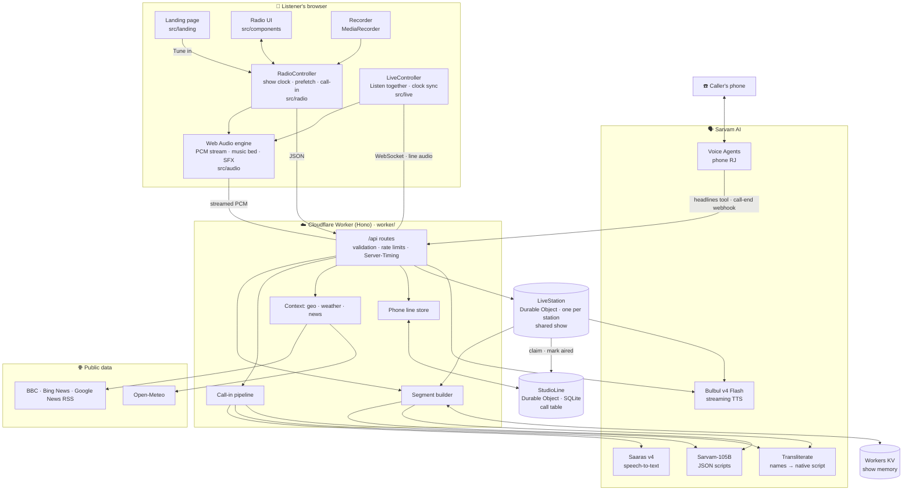

Three ideas carry the whole design:

- **The browser runs the show; the Worker writes it.** On the personal radio the client owns the clock, timing, audio and state. The Worker is stateless apart from two shared records, the studio line's call table (a Durable Object) and the show memory (KV), and answers one question at a time: *write this segment*, *speak this line*, *answer this caller*. The one exception is *Listen together* ([§12](#12-listen-together-one-shared-show-per-station)), where a Durable Object per station runs one shared show and the browser only keeps time.
- **Everything is streamed or prefetched.** Speech is piped byte by byte from Bulbul to the speaker, and the next line and next segment are always being prepared while the current one plays.
- **Every model output is checked before it's heard.** Scripts are validated, cleaned and cast on the server. Subtitles and phone messages are filtered. A crisis on a call-in never reaches the model.

## 2. From "Tune in" to first sound

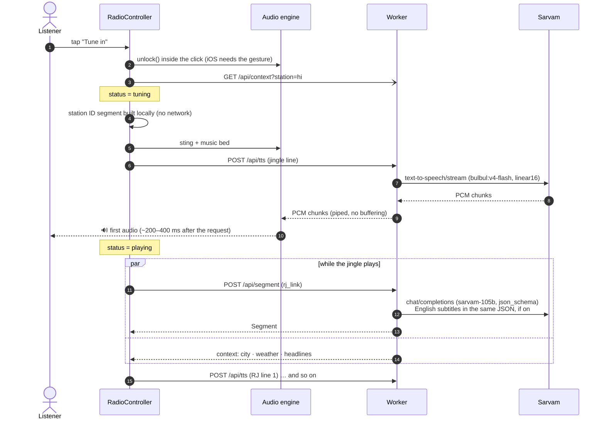

The station ID needs no model at all: `stationIdSegment()` in `src/radio/controller.ts` builds it from the station config, so the first sound only waits for one TTS request.

## 3. The show clock

The programme is a fixed loop (`SHOW_CLOCK` in `shared/constants.ts`). After the first pass it loops back to index 1, so the jingle plays once per tune-in.

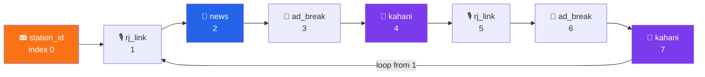

| Segment | Lines | Roles | Model temp | Timeout | Notes |
|---|---|---|---|---|---|
| `station_id` | 1 | `station_id` | n/a | n/a | Fixed text, built in the browser |
| `rj_link` | 2–5 | `rj` (the daypart's RJ on Hindi) | 0.7 | 10 s | Greets by name, reads phone dedications, teases what's next only if it's already written |
| `news` | up to 10 | `news` | 0.3 | 10 s | Rephrases up to 4 real headlines; invented numbers are dropped |
| `ad_break` | 4–7 | `ad_announcer`, `ad_customer` | 0.85 | 10 s | A fictional desi product, in one of 8 ad formats |
| `kahani` | 8–14 | `narrator`, `char_a`, `char_b`, `char_kid` | 0.85 | 15 s | Built from a fresh story brief; uses a caller's theme if there is one |

Source: `src/radio/clock.ts`, `worker/prompts.ts` (`SEGMENT_PLAN`, `MAX_LINES`), `worker/segment.ts` (`MIN_LINES`).

## 4. The radio controller's states

`RadioController` (`src/radio/controller.ts`) is a small state machine. The UI only renders `state.status` and never drives audio directly.

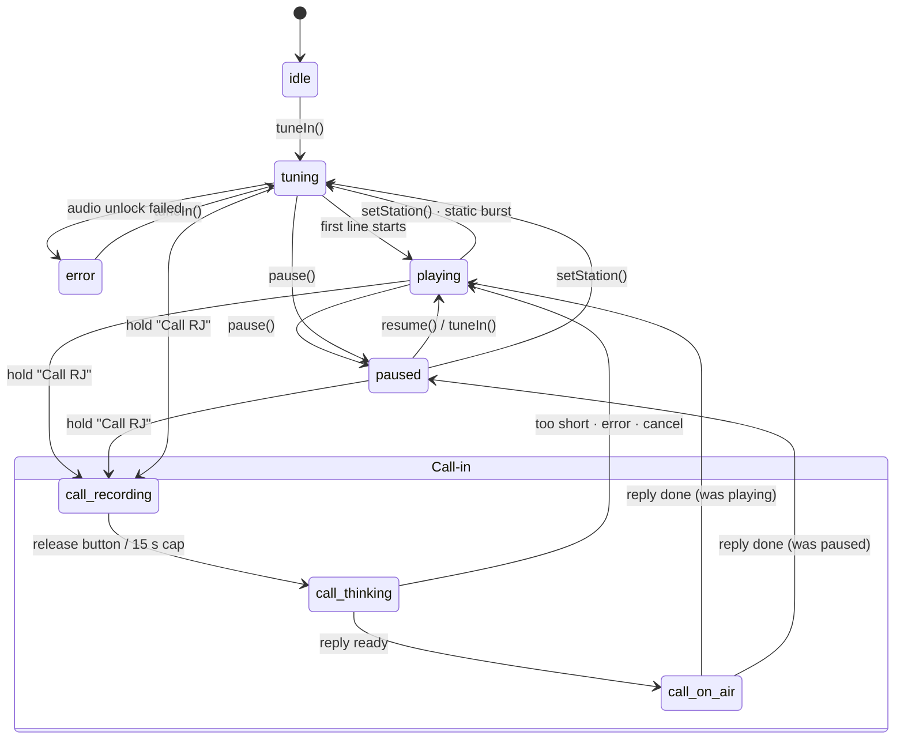

Every async action carries a **generation number** (`gen`). Switching station, pausing or starting a call bumps it, and any work from an older generation (a late segment, a TTS stream, a call reply) quietly drops itself. That is how a fast station switch never plays a stale line.

The phone-line poller runs only in `tuning`, `playing` and the call states, so a paused radio makes no background requests.

## 5. Prefetching: why there's no dead air

Two lookaheads run all the time:

```mermaid
gantt
  title Lookahead while segment n plays (illustrative)
  dateFormat  ss
  axisFormat  %S s
  section Audio out
  line 1 of segment n        :a1, 00, 4s
  gap                        :a2, after a1, 1s
  line 2 of segment n        :a3, after a2, 4s
  gap                        :a4, after a3, 1s
  line 3 of segment n        :a5, after a4, 4s
  section TTS fetches
  line 2 audio streaming     :t2, 00, 1s
  line 3 audio streaming     :t3, 05, 1s
  section Segment fetches
  write segment n+1 (LLM) :s1, 00, 5s
```

| Lookahead | Trigger | Code |
|---|---|---|
| **Next line's audio** | The moment line *i* starts, line *i+1*'s `/api/tts` stream is opened and read ahead into memory | `lineStarted()` → `ensureTts()` |
| **Next segment's script** | The moment segment *n* starts, segment *n+1* is requested. If it fails, the one after is warmed instead | `playSegment()` → `prefetchSegment()` |
| **Context** | Fetched on tune-in. A segment waits at most 4 s for it before going ahead without | `segmentRequest()` · `contextWaitMs` |

Old prefetches are aborted (`pruneSegments()`), so the browser holds at most the current and next segment.

## 6. How a segment gets written

`POST /api/segment` → `buildSegment()` in `worker/segment.ts`.

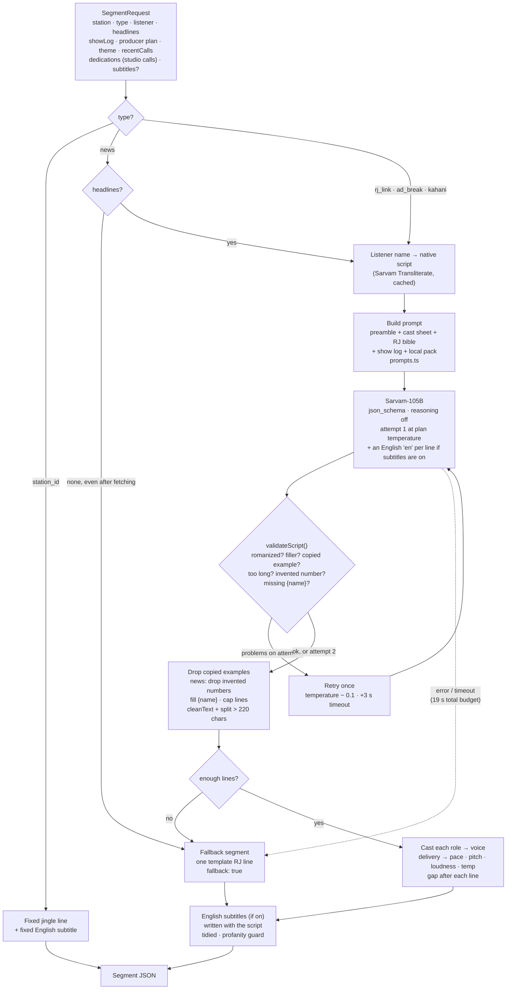

**What the model sees.** Each prompt carries: the station's preamble (native script only, no romanization, `।` punctuation, digits), a cast sheet with each role's grammatical gender, the RJ's character sheet, the last four aired segments as a show log (so the RJ can refer back), the producer plan (greet? catchphrase? running bit?), the mood of the previous segment (no jokes after heavy news), a local pack for known cities and any caller requests.

**Subtitles come with the script.** English subtitles are off by default. When the listener turns them on, the request carries `subtitles: true`, the JSON schema gains an `en` field right after each line's `text`, the system prompt gets a short subtitle rule (the meaning, not word for word, never changing the script) and the token budget grows by 40 % (`maxTokensFor()`). Upcoming segments that were already written without them are written again. `modelSubtitle()` (`worker/subtitle.ts`) tidies each subtitle and drops any that trips the profanity list. There is no separate translation step, so subtitles add no extra round trip.

**What the model never decides.** The voice, pace and loudness of each line; whether a news line keeps a number that isn't in the headlines; the listener's name spelling (`{name}` is filled by the server); and anything said to a caller in distress.

### Story briefs: why no two Kahanis sound alike

Before the model writes a word, `storyBrief()` (`worker/story.ts`) draws a premise from large pools: a genre for the time of day, a specific place (60 % from the station's own region, such as a Kolkata tram depot or a Kutch full-moon night), a hook object, a way of telling it, a twist type, the ending's feeling, and regional character names. That's about 3 million combinations per station and time of day. The prompt lists the night's earlier stories (`recentStories`) and bans stock openings and endings, and a quality gate retries a script that is mostly narration, has fewer than two speaking characters, or opens with a cliché.

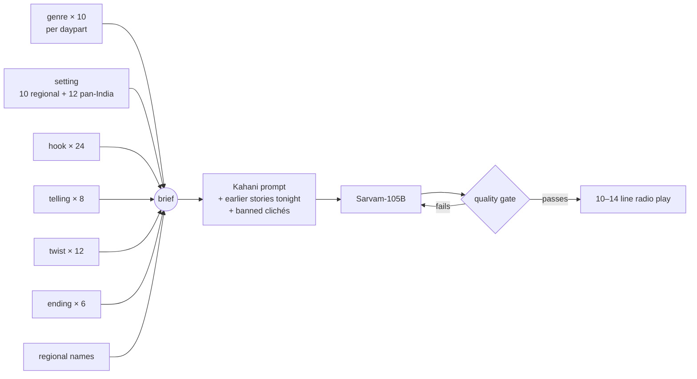

Each brief also picks **how the story opens** (cold open, one image, a question, an overheard scene, a note read aloud, or the ending first) and **how it lands** (a character's last line, a callback, a quiet image, a button joke, an open door). The title is woven in, never announced, and the RJ's hand-over into the story uses a different style each time. `castStory()` then casts it from the station's `storyPool` of verified voices, with a suspense narrator for ghost stories and night mysteries.

### Show memory: nothing repeats across listeners

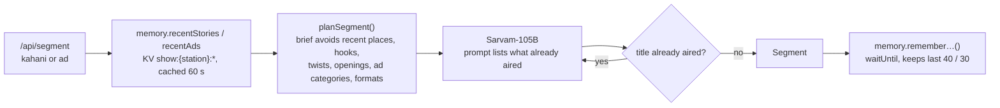

The memory lives in the `PHONE` KV namespace under `show:` keys, one rolling list per station and kind, expiring after 30 days of silence. Reads time out after 400 ms and failures are ignored, so a slow KV never delays the show. Template fallbacks are never remembered.

Ads draw a category and one of 8 formats (infomercial, breaking-news parody, helpline call, movie trailer, balcony gossip, cricket commentary, sad-violin, jingle), and RJ links can use one of several on-air devices (a listener poll, a mock traffic report for the kitchen…), so no two breaks share a shape.

## 7. How a line gets acted

Bulbul has no SSML. Each line instead gets a **delivery** from the script, and `voiceFor()` (`worker/show.ts`) turns the voice's base settings plus that delivery into API parameters.

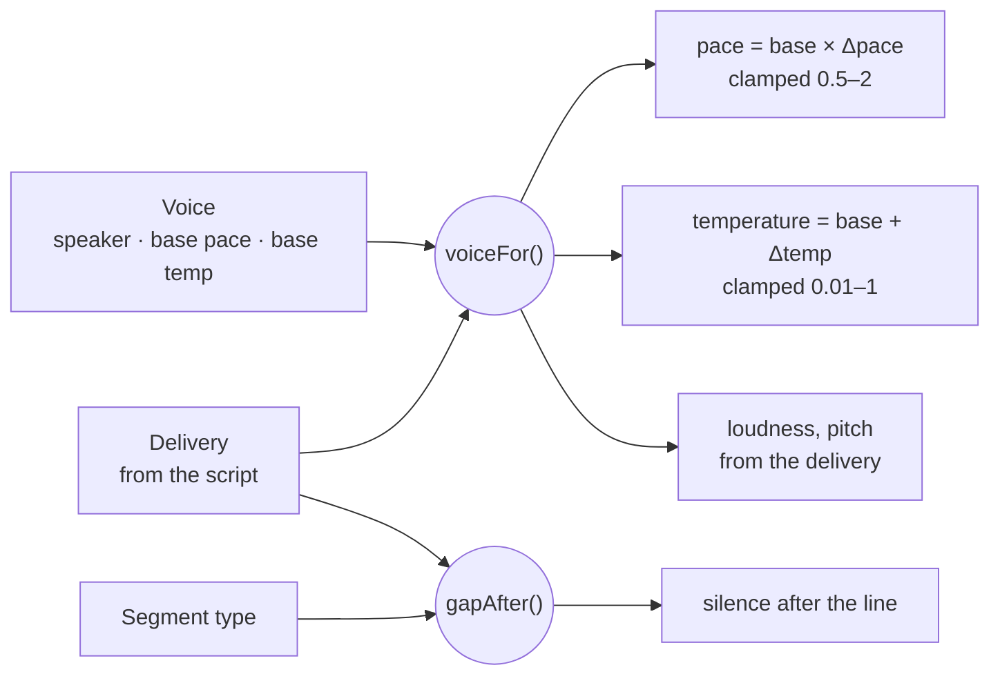

| Delivery | × pace | pitch | loudness | Δ temp | base gap |
|---|---|---|---|---|---|
| `normal` | 1.00 | 0 | 1.00 | 0 | 250 ms |
| `warm` | 0.93 | −0.05 | 0.95 | 0 | 350 ms |
| `excited` | 1.12 | +0.08 | 1.20 | +0.10 | 150 ms |
| `fast` | 1.35 | 0 | 0.95 | 0 | 100 ms |
| `hushed` | 0.88 | −0.10 | 0.60 | −0.05 | 400 ms |
| `shout` | 1.08 | +0.15 | 1.60 | +0.10 | 200 ms |
| `dramatic` | 0.85 | −0.12 | 1.05 | +0.05 | 550 ms |
| `sad` | 0.88 | −0.08 | 0.85 | −0.05 | 450 ms |

**Gap rules** (`gapAfter()`): a line split from a longer one gets 120 ms so it reads as one breath; news always uses a steady 300 ms; ads are 80 ms tighter; Kahani lines get 150 ms more; everything except news gets ±30 % random jitter so it never sounds metronomic. The floor is 60 ms.

Measured on `bulbul:v4-flash`: loudness 1.6 ≈ +3 dB and 0.6 ≈ −5 dB; pace 1.75 more than doubles speed, which is why `fast` stops at 1.35; pitch shifts are smaller than take-to-take variation, so they stay gentle.

## 8. Streaming speech into Web Audio

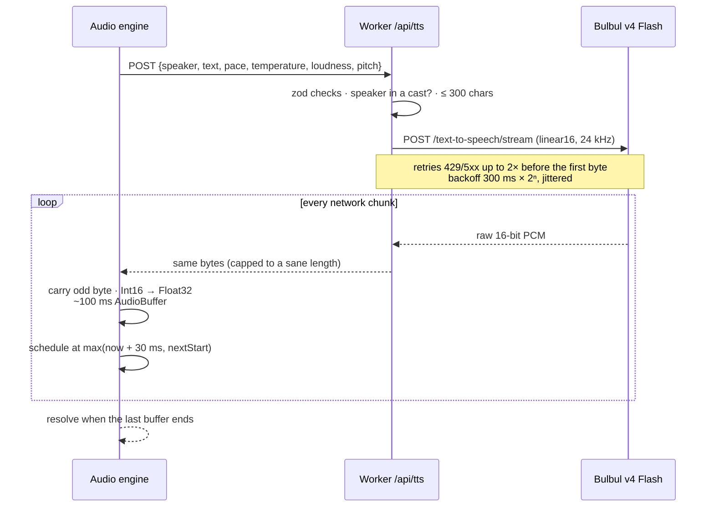

The audio graph (`src/audio/engine.ts`):

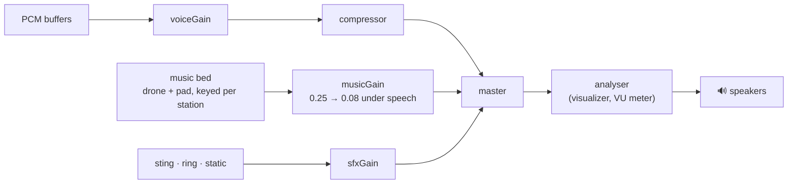

**Ducking:** when speech starts, the bed ramps to 0.08 in 150 ms. After 400 ms of silence it ramps back to 0.25 over 800 ms, so short gaps between lines don't make the music pump.

All music and effects are synthesized live (oscillators, noise, FM bells), so there is nothing to license and nothing to download.

## 9. Call-in: push to talk

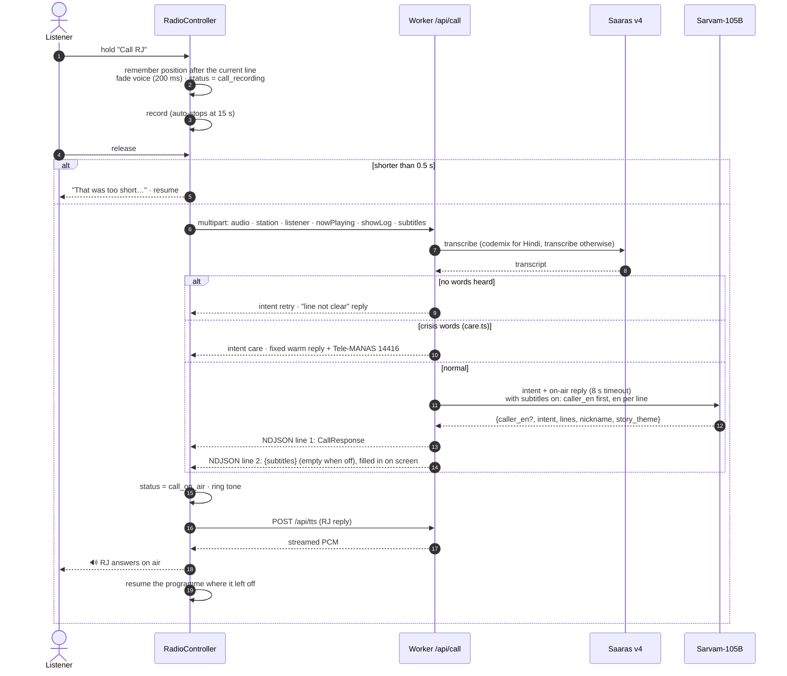

| `intent` | What happens next |
|---|---|
| `chat`, `dedication`, `news_request`, `other` | The RJ replies; the transcript joins `recentCalls`, so the next RJ link can mention it |
| `story_request` | The next Kahani gets the caller's theme ([§10](#10-a-story-request-rewires-the-clock)) |
| `deflect` | One cheerful "that's for off-air" line; the caller's words are not repeated |
| `retry` | Nothing was heard; the RJ asks them to call again |
| `care` | A fixed reply and a helpline banner on screen; the model's output is ignored |

## 10. A story request rewires the clock

`withStoryRequest()` in `src/radio/clock.ts`:

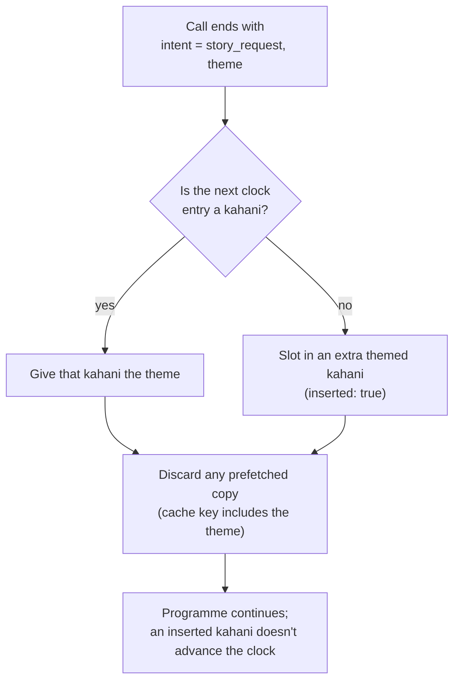

## 11. The studio phone line

The phone line (+91 79 6585 4148) is a Sarvam Voice Agent. It never talks to the browser directly; the Worker and the studio line's call table connect the two. The table is SQLite inside one Durable Object (`StudioLine`, `worker/studio.ts`), so every listener and every rejoin sees the same calls and the same "read on air" state at once. KV, which can take up to a minute to agree with itself, isn't used for calls.

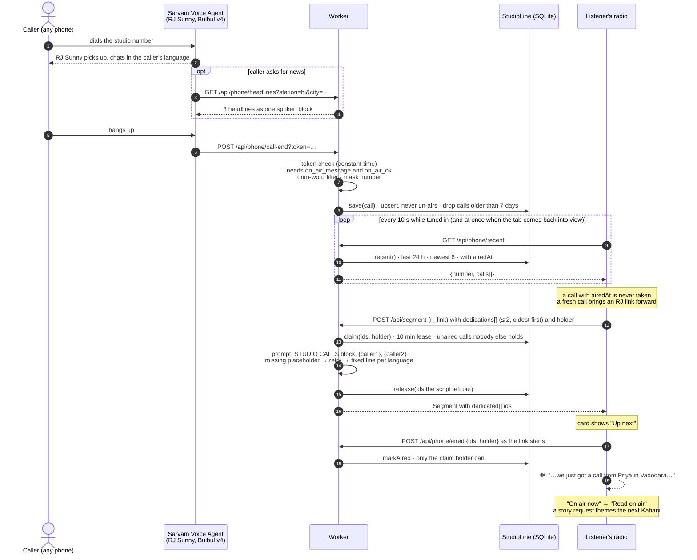

**Why a call is read once, ever.** Each tab has a random `holder` id (kept in `sessionStorage`, so a reload keeps it). An RJ link only gets the calls it could claim: unaired, and not held by another listener's live claim. The claim is a 10-minute lease, so a listener who leaves mid-way never blocks a call for long, and calls the script didn't use are released straight away. When the link starts playing, the browser marks its calls aired; from then on `/api/phone/recent` carries `airedAt`, every radio shows the call as *Read on air*, and no claim on it succeeds again. If another listener's RJ reads a call while this tab's upcoming link still holds it (only possible once a long pause let the lease run out), that link is written again without it. Calls from before the table went live were imported once from the old KV list and counted as read, since the old per-radio queue had already read them.

**How a fresh call jumps the queue.** RJ links come twice in each loop of the show clock, up to five or six minutes apart. When a call from the last 15 minutes is waiting, the browser doesn't wait for the clock: if the next segment is an RJ link, it is written again with the call in it; otherwise an extra RJ link is slotted in after the current segment (`inserted: true`, so the clock carries on as if it never ran, and the segment already written for the next slot moves along one place rather than being thrown away). Each call moves the queue once, and only when at least two lines of the current segment remain, so the new link is ready in time.

**Why every call gets read.** The RJ link receives each call as structured data (`dedications`), not as free text. The prompt makes reading them the link's one job and asks for a `{callerN}` placeholder where each name goes. The Worker checks for each placeholder: a missing one triggers the retry, and if the retry still skips a caller, a fixed studio-call line in the station's language is inserted before the closing tease. The returned `dedicated` ids tell the browser which calls were read; any call left out, or whose link fails or is dropped, goes back in the queue for the next RJ link.

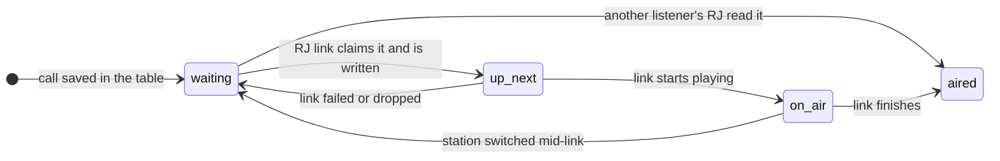

The caller's number is never stored in full: `maskNumber()` keeps only the country code and last four digits (`+91 ••••• 4148`).

## 12. Listen together: one shared show per station

`/live` turns the radio into a broadcast. Instead of a show per browser, each station runs one show on the server, and everyone tuned in hears the same line at the same moment. Each station is one Durable Object (`LiveStation`, `worker/live/station.ts`, addressed by station id); the wire contract is `shared/live.ts`.

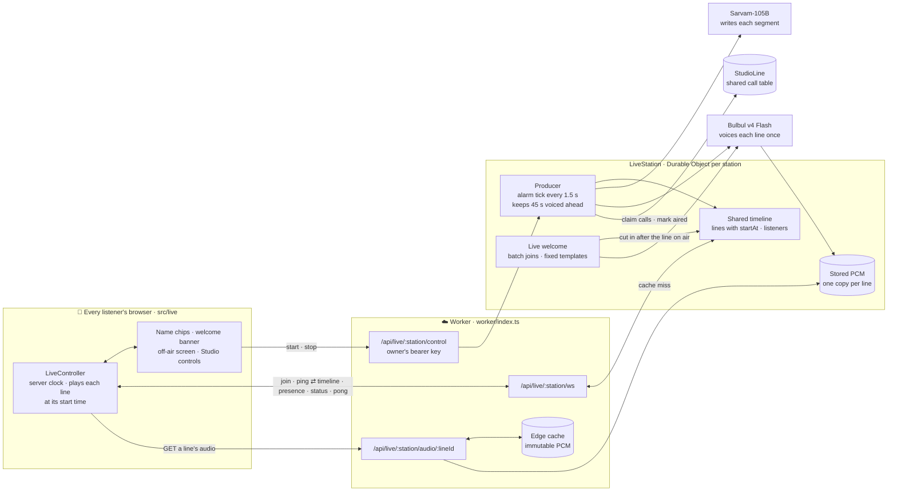

**The producer.** A station wakes when a listener joins (unless the owner has stopped it). Waking begins a fresh show (a new `showId`, the clock back at the jingle), and a storage alarm ticks every 1.5 s while anyone is listening. Whenever less than 45 s of voiced audio is queued ahead of the on-air clock, the next entry of the same `SHOW_CLOCK` as the personal radio is written by `buildSegment()`, the pipeline behind `/api/segment` ([§6](#6-how-a-segment-gets-written)). The context is shared rather than personal: India time, the most common city among the listeners (for the weather and city news) and no listener names in the script. Every live script carries English subtitles, since one script serves everyone; each listener decides whether to show them (off by default). Each line is voiced once by Bulbul (at most 3 requests in flight per station), its PCM is stored in the Durable Object, and the line goes on the timeline. A segment that fails twice is skipped, and the clock moves on.

**The timeline.** Every `LiveLine` carries its server start time (`startAt`) and its exact length from the PCM byte count (48 bytes per ms). A new line goes back to back after the last line and its pause, never sooner than 1.5 s from now, so every listener has time to fetch it (`appendLine()`, `worker/live/timeline.ts`). Each change sends the whole upcoming timeline to every listener. Finished lines drop off; their audio stays fetchable for 5 more minutes and is then deleted.

**One voice, many listeners.** Browsers fetch each line from `/api/live/:station/audio/:lineId`. The Worker answers from the edge cache when it can, otherwise asks the station and caches the reply (`Cache-Control: public, max-age=86400, immutable`). Sarvam is paid once per line whether 2 or 200 people (the cap per station) are listening, and the Durable Object serves a line roughly once per Cloudflare location. On `*.workers.dev` the Cache API is a no-op, so every fetch goes to the station.

**Clock sync and joining mid-line** (`src/live/controller.ts`, `src/live/clock.ts`). The browser pings over the socket (three quick pings on connect, then every 10 s) and keeps the median of the last five offsets, each worked out as server time − (send time + round trip / 2). It starts each line when its estimate of server time reaches `startAt` and fetches the next two lines ahead. Joining, or unmuting, part-way through a line plays the rest of it from the matching byte offset; a line that is more than 85 % over is skipped. A dropped socket reconnects with backoff (0.5 s growing to 15 s, up to 12 tries) while the timeline already received keeps playing.

**The live welcome** (`worker/live/welcome.ts`). Joins within 4 s of each other share one welcome. The line comes from fixed templates in Hindi, Marathi, Tamil, Bangla and Gujarati, chosen by the situation (alone in the studio, one new name, two, or a crowd) and filled with the names and how many are listening: "स्वागत है प्रिया! महफ़िल जम रही है, अब हम 2 लोग साथ हैं।" A crowd is shortened to a name or two and "2 more friends", and Latin-script names are transliterated into the station's script. The RJ on air at this hour voices it with the `excited` delivery, ahead of any programme lines waiting for TTS. `insertLine()` then cuts it in at the first line boundary at least 0.7 s away, which is right after the line on air, and pushes every later line back by the welcome's length plus a 400 ms gap. Welcomes start at least 12 s apart. Each welcome line lists the listener ids it greets, which lights the "…is welcoming you live!" banner in those browsers and an "On air now: a hello for …" note for everyone else.

**Name safety.** `sanitizeLiveName()` strips control characters, emoji, links, emails, @handles, hashtags and phone-number-like digit runs, keeps Latin and Indic letters, drops a leading "my name is", and caps the name at 24 characters on a word boundary. Abuse in Latin script, Devanagari, Bengali, Tamil or Gujarati, and anything that reads like an instruction or spam ("ignore", "prompt", "whatsapp" …), is rejected, and that listener is welcomed with the station's word for friend. A name never reaches Sarvam-105B; it only fills a template.

**Studio calls on a live show.** Each RJ link asks the shared call table (`StudioLine`, [§11](#11-the-studio-phone-line)) for up to two unread calls, oldest first, and claims them as `live:<station>:<showId>`. Calls the script leaves out are released at once. When the link's first line is placed, its start time is noted, and the first alarm tick after that moment marks the calls aired. A call therefore reaches exactly one RJ, on whichever show claims it first, live or personal, and every radio then shows it *Read on air*. A show that stops hands back any calls it claimed but never aired, and a caller's story request themes the live show's next Kahani.

**Auto-start, the show limit and the studio override.** No one has to switch a station on: a join to a sleeping station wakes it, and the station switches itself off after a minute with nobody listening (`LIVE_IDLE_SLEEP_MS`). Each show ends after 6 minutes (`LIVE_AUTO_OFF_MS`, `enabledUntil` in the snapshot), whatever is happening: everyone still connected gets the `show_ended` note (`LIVE_ENDED_NOTE`) and a "The show took a short break" card with **Tune in again**, which sends `{"type":"restart"}` and starts a fresh 6-minute show for everyone there, with a welcome each. A station takes at most one restart per 30 s (`LIVE_RESTART_GAP_MS`), and while listeners sit on an ended show, joins and reconnects never restart it on their own (a minute after the last one leaves, a join does again). `POST /api/live/:station/control` with the owner's key (`Authorization: Bearer <LIVE_ADMIN_TOKEN>`, compared in constant time, 401 otherwise) is the override: `{"action":"stop"}` puts the show to sleep with the `off_air` note and blocks auto-start, so listeners stay connected on the "Off air right now" screen and the join form says so; `{"action":"start"}` lifts the block and wakes the show at once for anyone waiting. Every stop, by hand or automatic, deletes the show's stored audio and releases unaired calls. The owner opens `/live?admin=<key>`: the key is saved in the browser and removed from the address bar, and the Studio controls list every station as Auto, Warming up, On air or Blocked, with its listener count and the show's countdown (refreshed every 10 s), with Start, Stop and Stop all. Two more guardrails: at most 600 segments per station per India day, and 200 listeners per station.

## 13. News and listener context

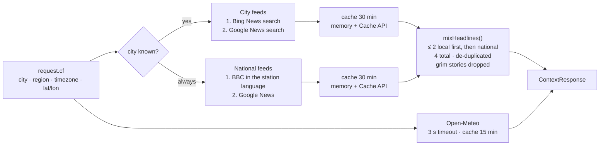

- The first feed in each list that returns items wins (`firstFeed()`); later ones are only tried on failure.
- Bing's click-tracker links are unwrapped to the publisher's URL, so the sources shown on screen point at the real article.
- On `*.workers.dev` the Cache API is a no-op, which is why there's also a per-isolate memory cache.
- No location prompt is ever shown: everything comes from Cloudflare's edge.

## 14. Safety layers

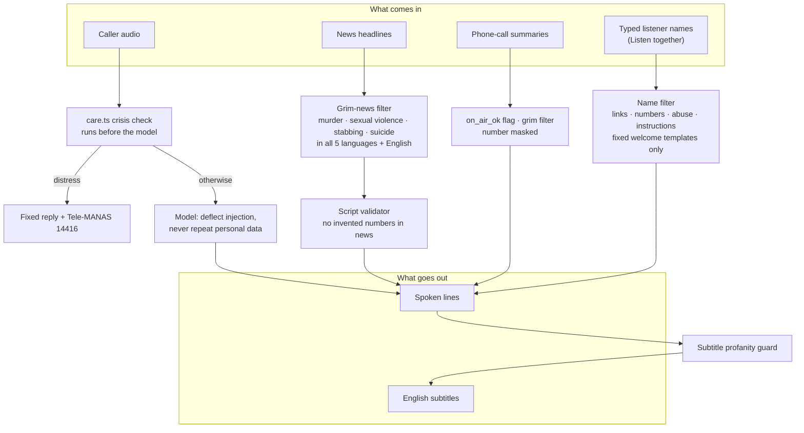

On the infrastructure side: the Sarvam key only lives in the Worker; `/api/tts` only speaks with voices from the station casts; inputs are validated with zod; recordings are capped at 2 MB and 15 s and never stored; and the three routes that cost money are rate-limited per IP.

Spending stops when nobody is listening. The personal radio pauses itself after 6 minutes with no tap, key press or call and asks "Still listening?" (`listenCapMs` in `src/radio/controller.ts`; a call in progress is never cut off), so a forgotten tab stops writing and voicing segments. A live show ends after 6 minutes until a listener taps Tune in again, a live station switches itself off a minute after the last listener leaves, and it writes at most 600 segments a day ([§12](#12-listen-together-one-shared-show-per-station)).

## 15. Failure handling

| What fails | What the listener hears | Where |
|---|---|---|
| Model returns a bad script | One retry at a lower temperature; then a one-line RJ filler | `worker/segment.ts` |
| Model times out / errors | RJ filler (`fallback: true`) | `worker/segment.ts` |
| No headlines at all | News is replaced by an RJ filler | `buildSegment()` |
| Segment request fails in the browser | One retry after 800 ms; then the clock skips to the next segment | `fetchSegment()` |
| Three segments in a row fail | "Weak signal. Retrying…" and a 3 s back-off | `run()` |
| One line's TTS fails | Its caption shows for 2 s, then the show moves on | `playLine()` |
| A subtitle is missing, empty or profane | The native caption shows without it | `modelSubtitle()` |
| Weather or a news feed fails | The last cached value, or nothing | `worker/context.ts` |
| Call-in model fails | A warm "thanks for calling" line | `worker/call.ts` |
| Mic blocked / recording empty | A message under the call button; the show resumes | `startCall()` · `endCall()` |
| Call table unreachable | No phone calls listed, and RJ links go without them; the show is unaffected | `/api/phone/recent` · `/api/segment` |
| KV unreachable | The show memory is skipped; stories and ads are still checked against this session's own log | `worker/memory.ts` |
| A live segment fails twice, or one of its lines can't be voiced | The segment (or that line) is left out and the live clock moves on; the timeline closes up | `writeNext()` · `enqueue()` |
| Live socket drops | "Reconnecting…"; the timeline already received keeps playing while it retries with backoff | `src/live/controller.ts` |
| A live line's audio fails to load | The caption stays up, silent, until the line's end time, so the listener stays in step | `playEntry()` |

## 16. Deployment

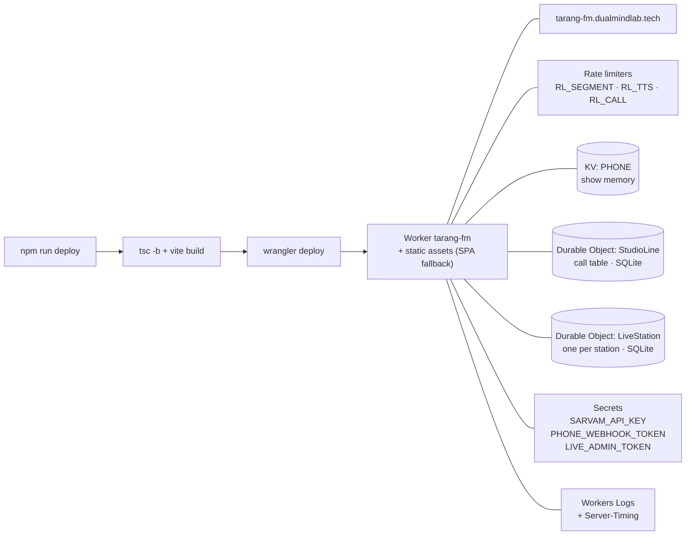

`/api/*` runs the Worker first (`run_worker_first`); every other path is a static asset, and unknown paths such as `/listen` and `/live` fall back to `index.html` for the client-side router.

## 17. Numbers worth knowing

| Thing | Value | Defined in |
|---|---|---|
| TTS sample rate | 24 kHz, 16-bit mono PCM | `shared/constants.ts` |
| Max characters per spoken line | 220 (split at sentence ends) | `MAX_LINE_CHARS` |
| Max characters per TTS request | 300 | `TTS_MAX_CHARS` |
| Call-in recording | 0.5–15 s, ≤ 2 MB | `CALL_MAX_SECONDS`, `CALL_MAX_BYTES` |
| Segment budget (both attempts) | 19 s | `SEGMENT_BUDGET_MS` |
| Call-in model timeout | 8 s | `CALL_PLAN` |
| Headlines per bulletin | 4 (≤ 2 local) | `NEWS_LIMIT`, `LOCAL_LIMIT` |
| News / weather cache | 30 min / 15 min | `worker/context.ts` |
| Phone poll | every 10 s, and on returning to the tab | `DEFAULT_TIMINGS.phonePollMs` |
| Phone calls kept / shown | 7 days in the call table / 6 from the last 24 h | `worker/calls.ts` |
| Claim lease on a call | 10 min | `CLAIM_LEASE_MS` |
| A call brings an RJ link forward if made within | 15 min | `PHONE_JUMP_MS` |
| Dedications per RJ link | up to 2 | `MAX_PHONE_CALLS_PER_LINK` |
| Rate limits per IP | segment 30/min · tts 120/min · call 8/min | `wrangler.jsonc` |
| Personal show pauses ("Still listening?") after | 6 min with no tap, key press or call | `DEFAULT_TIMINGS.listenCapMs` |
| Live station switches itself off after | 6 min from Start, whatever happens | `LIVE_AUTO_OFF_MS` |
| … or with nobody listening, after | 3 min | `LIVE_IDLE_SLEEP_MS` |
| Live audio kept voiced ahead of the on-air clock | 45 s | `LIVE_BUFFER_AHEAD_MS` |
| Earliest a new live line starts | 1.5 s after it is placed | `MIN_LEAD_MS` |
| Live welcome: joins batched / gap between welcomes | 4 s / at least 12 s | `LIVE_WELCOME_BATCH_MS`, `LIVE_WELCOME_MIN_GAP_MS` |
| Live welcome placement | first line boundary ≥ 0.7 s ahead, then a 400 ms gap | `WELCOME_LEAD_MS`, `WELCOME_GAP_MS` |
| Live clock sync | 3 pings on connect, then every 10 s; median of the last 5 | `src/live/clock.ts` |
| Listeners per live station / name length | 200 / 24 characters | `LIVE_MAX_LISTENERS`, `LIVE_NAME_MAX` |
| Live segments per station per India day | 600 | `DAILY_SEGMENT_LIMIT` |
| Live line audio kept after the line ends | 5 min in the station, 1 day in the edge cache | `AUDIO_KEEP_MS`, `/api/live/:station/audio` |
| Measured warm TTS first byte | 190–390 ms | spike, TECH-SPEC §11 |
| Measured call-in round trip | 1.7–2.5 s | TECH-SPEC §8.6 |
