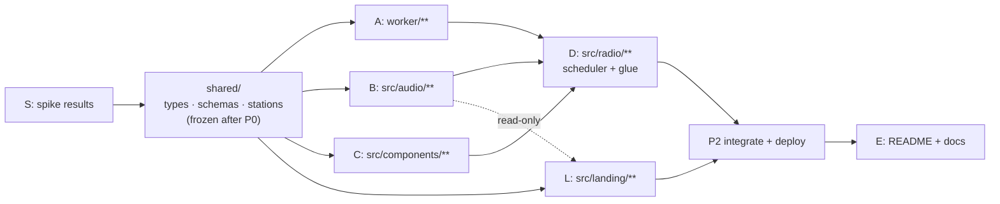

# Tarang FM: Build Plan

**Time box: 4–5 hours** from the start of build, with several workstreams running in parallel. Scope is the PRD's **Must ship** list (§6.1). The **If time** items (§6.2) are started only after the MVP is deployed and passes the smoke test.

> This is the plan as written before the build started. The shipped scope grew past it (five stations, a phone line, daypart shows); see PRD §11 for what was added.

Related: [How it works](./ARCHITECTURE.md) · [PRD](./PRD.md) · [Tech spec](./TECH-SPEC.md) · [Voice casting](./VOICE-CASTING.md)

---

## 1. Timeline

| Phase | Clock | Who | Output | Exit criteria |
|---|---|---|---|---|
| **P0 Foundation** | T+0:00 → 0:40 | Lead (+ Track S in parallel) | Scaffold, frozen contracts in `shared/`, spike results | `npm run dev` serves a blank app + `/api/health`. `shared/types.ts`, `schemas.ts`, `stations.ts` committed. Spike answers TECH-SPEC §11 |
| **P1 Parallel build** | T+0:40 → 2:40 | Tracks A, B, C, D | Worker API, audio engine, UI, scheduler | Each workstream's acceptance tests pass on its own (§2) |
| **P2 Integrate + deploy** | T+2:40 → 3:20 | Lead + D | Hindi station end-to-end on a public URL | 10 minutes of Hindi with no dead air. A call-in works on desktop and phone |
| **P3 Stations + hardening** | T+3:20 → 3:50 | A + C | Tamil + Bangla live, fallbacks verified, mobile QA | QA matrix (TECH-SPEC §11) passes |
| **P4 Ship** | T+3:50 → 4:30 | Lead + Harsh | README, demo video, public repo, X/LinkedIn post, Discord submission | Submission posted |
| **If time** | after P3 passes | Whoever is free | PRD §6.2, in order T1 → T9 | Each item deployed and smoke-tested before the next starts |

```mermaid
gantt
  title Build time box (hours from start)
  dateFormat HH:mm
  axisFormat T+%H:%M
  section Lead
  P0 Foundation (scaffold, contracts)   :p0, 00:00, 40m
  P2 Integrate + deploy                 :p2, 02:40, 40m
  P4 Ship (README, video, posts)        :p4, 03:50, 40m
  section Spike
  S API spike + voice audition          :s, 00:00, 40m
  section Parallel tracks
  A Worker API                          :a, 00:40, 2h
  B Audio engine                        :b, 00:40, 2h
  C UI                                  :c, 00:40, 2h
  D Scheduler + glue                    :d, 00:40, 2h
  L Landing page                        :l, 00:40, 2h
  section Hardening
  P3 Stations + QA                      :p3, 03:20, 30m
```

If P1 runs over by 30 minutes, cut in this order: news `sources` UI → ad break → Bangla station. Never cut call-in, captions or Kahani.

## 2. Workstreams and file ownership

Each track edits **only** its owned paths. `shared/` is frozen after P0. A contract change goes through the lead and lands in TECH-SPEC in the same commit.

| WS | Owner | Owns | Builds against | Acceptance |
|---|---|---|---|---|
| **S: Spike** | Track S | `scripts/spike.ts`, `scripts/audition.ts`, `tmp/audition/` | Sarvam API | Writes the answers to TECH-SPEC §11 and the audition `Gender` column into VOICE-CASTING.md, and tells the lead before P1 starts |
| **A: Worker API** | Track A | `worker/**` | TECH-SPEC §5, §6, §8, §10 | `curl` on each route returns a valid contract response. `/api/tts` streams audio that plays. `/api/segment` returns valid segments for all 4 types in `hi`, `ta`, `bn`. Vitest for `cleanText` |
| **B: Audio engine** | Track B | `src/audio/**` | TECH-SPEC §7 | A test page (`?debug=audio`) plays a streamed `/api/tts` line gaplessly, ducks the music bed, plays the sting and call tone, and records and returns a Blob. Vitest for the PCM converter |
| **C: UI** | Track C | `src/components/**`, `src/index.css`, `index.html`, `public/**` | TECH-SPEC §4 (`Station`, `Line`) + §9 store shape | All states render with mock store data: idle, tuning, playing (with captions and speaker chip), call recording / thinking / on air, error. Mobile at 360 px. Keyboard reachable |
| **D: Scheduler + glue** | Track D (or Lead) | `src/radio/**`, `src/App.tsx` | §5 API + §7 engine + §9 | Show clock loops with prefetch. Station switch and call-in flows work against the real API |
| **L: Landing page** | Track L | `src/landing/**` | PRD M16, shared stations/casts, `src/audio` engine (read-only) | `Landing({ onTuneIn })` renders all sections, plays voice samples via `/api/tts`, mobile 360 px, a11y |
| **E: Docs + launch** | Lead / Harsh | `README.md`, `docs/**` | n/a | README with live link, GIF/video, architecture, Sarvam models used, setup |

**Lead responsibilities:** P0 scaffold and contracts, merging and integration, deploys, reviewing commits, and keeping the time box.

## 3. Commit plan

Small, conventional commits, each one buildable. A rough sequence:

1. `docs: add PRD, technical spec, voice casting and build plan`
2. `chore: scaffold Vite React app with Cloudflare Worker`
3. `feat(shared): add station configs, types and schemas`
4. `feat(worker): stream Bulbul v4 Flash speech through /api/tts`
5. `feat(worker): generate radio segments with Sarvam-105B`
6. `feat(worker): add call-in pipeline with Saaras v4 and RJ replies`
7. `feat(worker): fetch listener context and news headlines`
8. `feat(audio): add streaming PCM engine with music bed and ducking`
9. `feat(audio): add push-to-talk recorder`
10. `feat(ui): build tuner, now-playing card and live captions`
11. `feat(radio): add show scheduler with prefetch and station switching`
12. `feat(radio): wire call-in flow into the programme`
13. `feat: add Tamil and Bangla stations`
14. `fix: …` (as found in QA)
15. `docs: write README with demo and setup`

Before every commit: run `git status` and confirm no ignored or local-only files (`.dev.vars`, scratch files) are staged. Author: Harsh Bhanushali. No AI attribution anywhere.

## 4. Environment setup (P0)

1. Put `SARVAM_API_KEY=...` in `.dev.vars` (Harsh adds it; it's gitignored).
2. `npm install`, then `npm run dev`.
3. Production: `npx wrangler secret put SARVAM_API_KEY`, then `npm run deploy`.
   - Worker name: `tarang-fm`.
   - URL: `https://tarang-fm.<account-subdomain>.workers.dev`.

## 5. Definition of done (MVP)

- [ ] Public URL plays Hindi, Tamil and Bangla stations from a single Tune in tap
- [ ] Every segment type (station_id, rj_link, news, ad_break, kahani) plays in all 3 stations
- [ ] Captions show speaker name and V4 speaker ID for every line
- [ ] Call-in works in Hindi and Tamil. A story request changes the next Kahani
- [ ] No dead air > 2 s over 10 minutes. Errors fall back gracefully
- [ ] Works on Android Chrome and iOS Safari
- [ ] API key is not exposed (check network tab and bundle). Rate limits are active
- [ ] README complete. Repo public. No AI-tool files in git history

## 6. Demo video (75–90 s) shot list

Record on a phone with screen recording **and device audio** on (iOS: Control Centre → Screen Recording; Android: Screen recorder → "Media sounds"). Do one warm-up run first so the news and first segments are cached.

**Before recording:** type your name on the tune-in screen. Have a second phone ready to dial the studio line.

1. (0–5 s) Open the link, tap **Tune in now**. The jingle plays over the sting.
2. (5–18 s) The RJ greets you by name and city and mentions the weather. Point at the `sunny_hi_reels` speaker chip and the English subtitle.
3. (18–30 s) News: your city first, then national. Scroll to the sources card. Let one ad play (two voices, a new ad format every break).
4. (30–48 s) **The phone line:** on the second phone, call +91 79 6585 4148 and leave a dedication. Back on the radio, the studio panel shows the call as *In the queue*, then *Up next*, then *On air now* while the RJ reads it by name.
5. (48–62 s) Kahani: narrator, then two characters, then the kid. The speaker chip changes on every line. Let the twist land.
6. (62–75 s) Hold **Call RJ** and say "एक भूतिया ट्रेन की कहानी सुनाओ!" The RJ answers within a couple of seconds, and the next Kahani is announced on your theme.
7. (75–85 s) Turn the dial to Tamil, then Gujarati: static, a new jingle, native voices.
8. (85–90 s) End card: "Tarang FM · every voice is Sarvam Bulbul v4 Flash" plus the URL.

**After recording:** upload the video by dragging it into a GitHub issue or PR comment, copy the `https://github.com/user-attachments/…` link it gives you, and paste that link on its own line under **Demo** in the README. GitHub then shows a player there. Use the same file for the X/LinkedIn post.

## 7. Submission checklist (deadline 15 Oct 2026, 8 PM IST; aim to finish 2 hours early)

- [ ] Repo public, README has the live link and demo video
- [ ] X or LinkedIn post **quoting Sarvam's official Bulbul announcement** (https://x.com/SarvamAI/status/2109980905318326594), with the demo video and live link
- [ ] Discord post in the projects channel, tag `Sarvam Bulbul Build Challenge`:
  - **Name:** Harsh Bhanushali
  - **Project:** one-paragraph description (from PRD §1)
  - **Social Post:** link
  - **GitHub:** repo link
