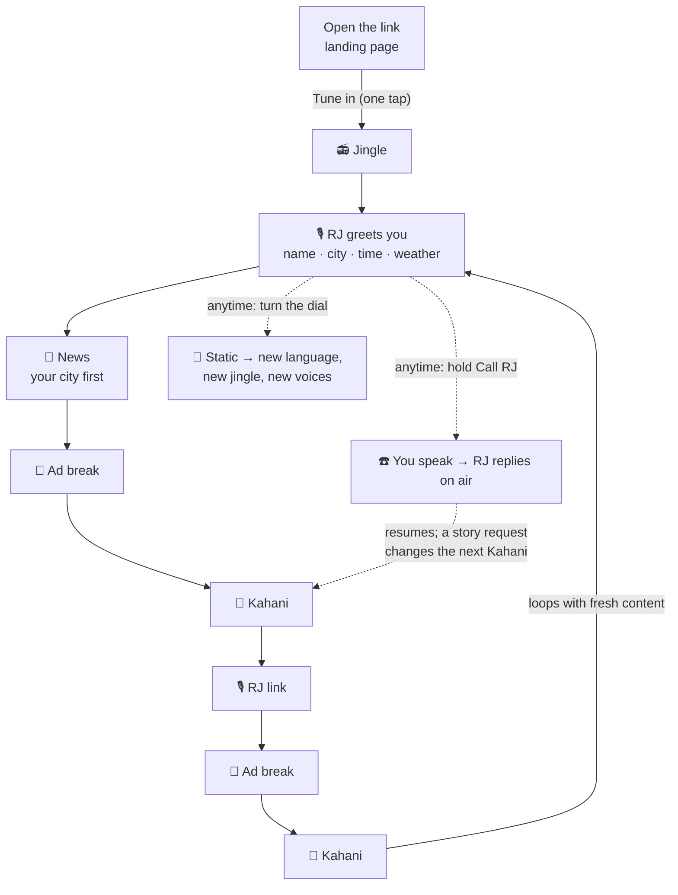
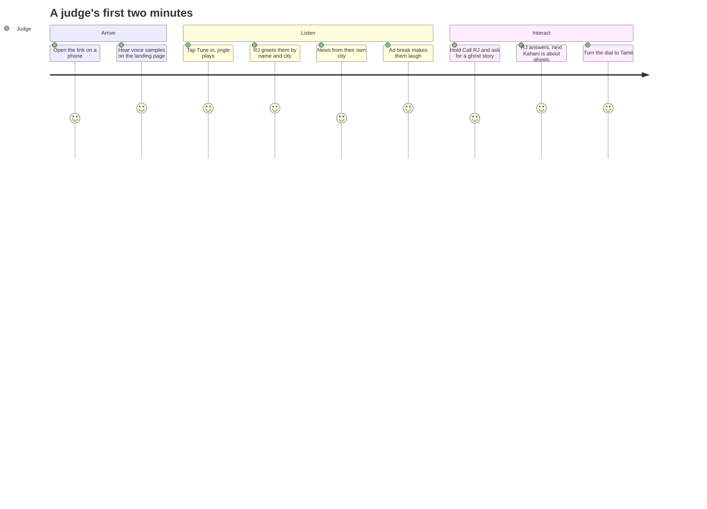
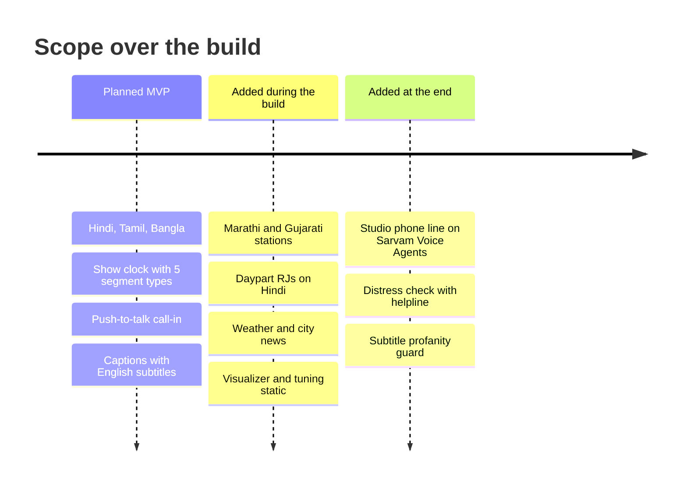

# Tarang FM: Product Requirements Document

| | |
|---|---|
| **Product** | **Tarang FM** (तरंग, "wave"): an AI-run Indian radio station in the browser |
| **Version** | PRD v1.1 (scoped to a 4–5 hour build) |
| **Date** | 14 October 2026 |
| **Owner** | Harsh Bhanushali |
| **Event** | Sarvam Bulbul Build Challenge, "Build something that speaks". Deadline 15 Oct 2026, 8 PM IST |
| **Models** | **Bulbul v4 Flash** (`bulbul:v4-flash`) for voice, **Saaras v4** for speech-to-text, **Sarvam-105B** for writing and understanding |

Related: [How it works](./ARCHITECTURE.md) · [Technical spec](./TECH-SPEC.md) · [Voice casting](./VOICE-CASTING.md) · [Build plan](./BUILD-PLAN.md)

---

## 1. Summary

**Tarang FM** (तरंग, "wave") is a live, personalized radio station voiced entirely by AI. Open a link, press **Tune in**, and a station starts playing in your language:
- a jingle
- an RJ who greets you by name and city
- a news bulletin built from today's headlines
- a funny ad break
- a short radio drama with a full voice cast

Hold **Call RJ** at any time, speak in your language, and the RJ answers you on air within seconds. Turning the dial switches stations, and each station is a different Indian language with its own native voices.

Every segment of a radio station has its own vocal style: news, ads, drama, late-night, kids. Bulbul v4 Flash's 224 live voices are organized by exactly those styles, so a radio station is the most natural way to show the model's range.

## 2. Problem

- Most voice demos use one or two voices in one language. That undersells V4 Flash, whose main advance is a large catalog of personas that differ by style.
- Many voice-AI demos need local installs or OS permissions, so most people only read about them and never hear them.
- Radio is the most familiar audio format across India, but personalized, multilingual audio programming normally needs studios and voice artists.

**Our answer:** a web radio that anyone, including a judge on their phone, hears within seconds of opening a link. It shows many V4 voices, a live conversation and several Indian languages in one familiar experience.

## 3. Goals

| # | Goal | Measured by |
|---|---|---|
| G1 | Show the breadth of Bulbul v4 Flash | ≥ 12 distinct V4 speaker IDs heard in a 10-minute session. Every line shows its speaker ID on screen |
| G2 | Instant for anyone | Public URL, no install, no login. First audio ≤ 3 s after pressing Tune in |
| G3 | A real conversation | Call-in: from end of speech to first reply audio in ≤ 3 s p50 |
| G4 | Multilingual India | 3 language stations at minimum (Hindi, Tamil, Bangla). Shipped with 5: Marathi and Gujarati were added |
| G5 | Never goes silent | Failures fall back to template lines or skip a segment. No dead air longer than 2 s |
| G6 | Ship on time | Live URL, README, demo video, social post and Discord submission done within the build window |

**Budget is not a constraint** (about ₹25,000 Sarvam credits plus Cloudflare credits). Optimize for quality and latency. Abuse limits exist only to protect a public link.

### Non-goals
- Music or song generation, or real songs (copyright). Music beds are synthesized in the browser.
- Voice cloning (beta, separate endpoints, not V4).
- Malayalam and Odia (no V4 personas yet).
- Accounts, history, native apps.

## 4. Users

| User | What they do |
|---|---|
| **Judge / Sarvam team member** (primary) | Opens the link on a phone, hears several V4 voices within seconds, calls in once, switches to a second language |
| **Indian listener** | Tunes into their language, calls in with a dedication or story request |
| **Low-literacy or elderly listener** | Hears news in their language. Large captions are available |

## 5. Experience

**Screens:**
- **Tuner** (single page).
  - Station dial and now-playing card: segment title, speaker name, **V4 speaker ID chip**, live captions.
  - Controls: Tune in / pause, Call RJ.
  - Footer: "Powered by Sarvam Bulbul v4 Flash · Saaras v4 · Sarvam-105B" and source credits.
- **Call-in state.** The Call RJ button shows the recording level, then "On air…", then the caller's transcript and the RJ's reply as captions.

**Principles:**
- **Audio first, captions always.** This helps accessibility and lets judges see which V4 voice is speaking.
- **No dead air.** Prefetch the next line and the next segment.
- **One tap to start**, since browsers need a user gesture to play audio.
- **Honest labels.** News links to the source headlines, and the footer says hosts and stories are AI-generated.

## 6. Requirements

### 6.1 Must ship (MVP)
| ID | Requirement |
|---|---|
| M1 | **Five stations:** Hindi (`hi-IN`) 91.1, Marathi (`mr-IN`) 94.3, Tamil (`ta-IN`) 98.3, Bangla (`bn-IN`) 102.7, Gujarati (`gu-IN`) 106.1, each with a name, frequency label, tagline, accent colour and voice cast ([VOICE-CASTING.md](./VOICE-CASTING.md)) |
| M2 | **Show clock** per station, looping: `station_id → rj_link → news → ad_break → kahani → rj_link → ad_break → kahani → …` |
| M3 | **Station ID.** A fixed jingle line per station in an ads voice, over a synthesized sting |
| M4 | **RJ link.** 2–4 lines, personalized with listener name, city and time of day, teasing what's next |
| M5 | **News.** 3–4 current headlines from a public RSS feed in the station's language, rephrased for radio by Sarvam-105B (rephrase only, no new facts). Sources listed on screen |
| M6 | **Ad break.** One fictional, funny ad with two voices (announcer + customer). No real brands or people |
| M7 | **Kahani Corner.** 8–12 line mini drama with a narrator and up to 3 characters, each in a different V4 persona |
| M8 | **Call-in.** Push-to-talk, up to 15 s → Saaras v4 → Sarvam-105B (intent + short reply in the RJ's voice and the station language) → Bulbul streamed reply → programme resumes. A `story_request` makes the next Kahani use the caller's theme |
| M9 | **Live captions** for every line, with speaker name and V4 speaker ID |
| M10 | **Audio engine.** Gapless streamed playback, a procedural music bed that ducks under speech, a sting between segments |
| M11 | **API key server-side only.** Per-IP rate limits on generation and call-in endpoints. TTS allowed only for speakers in our cast |
| M12 | **Fallbacks.** LLM failure → retry once → template RJ filler and skip the segment. TTS failure → show the caption and continue |
| M13 | **Mobile-first**, responsive from 360 px, keyboard accessible. Works in current Chrome, Edge, Firefox and Safari (iOS 16.4+) |
| M14 | **Deployed** on Cloudflare with a public URL. README with demo GIF/video and setup steps |
| M15 | **Readable by everyone**: each caption shows the spoken line in its native script, and one tap adds an English subtitle underneath (off by default; written by Sarvam-105B together with the script). All UI copy (buttons, labels, states) is in English or light Hinglish, never Hindi-only |
| M16 | **Landing page** at `/`: hero with a Tune in CTA that starts the radio in the same click, the programme, "Meet the voices" (every cast persona playable, with its V4 speaker ID), the call-in explainer, Built on Sarvam, and footer credits. The radio app lives at `/listen` |

### 6.2 If time (in this order; start one only when every MVP item is done and deployed)
| # | Item | Why it matters |
|---|---|---|
| T1 | Marathi station (`mr-IN`, 9 voices) | Fourth language, rich cast |
| T2 | Time-of-day programming: night uses `ratan_hi_latenight_warm` as RJ plus suspense Kahani; morning uses a devotional or upbeat intro | Shows more V4 styles |
| T3 | Weather line in the RJ link (Open-Meteo, location from Cloudflare) | Feels personal |
| T4 | Audio visualizer + tuning static between stations | Wow factor in the demo video |
| T5 | ⚡ TTFA (time to first audio) overlay per line | Shows how fast V4 Flash is |
| T6 | Hinglish/English station (`enhi` + `en` voices), then Telugu, Kannada, Punjabi, Gujarati | All 9 V4 languages |
| T7 | Dedications: the RJ reads the caller's dedication with a shayari | Radio charm |
| T8 | Share-a-clip link (replays a cached segment from R2) | Helps the social post spread |
| T9 | Instant news: a Cron Trigger pre-builds each station's bulletin into KV every 30 min | Faster start, uses Cloudflare well |
| T10 | Faster call-in replies over the Bulbul WebSocket (stream LLM sentences into TTS) | Lower latency |
| T11 | Dedication wall (D1) + live stats panel (Analytics Engine: listens, call-ins, TTFA) | Social proof, shows performance |
| T12 | Live broadcast mode: one shared timeline per station (Durable Object), call-ins heard by everyone tuned in, listener count | Big wow, but high risk. Only if everything else is done |

## 7. Content rules

- **Bulbul v4 Flash writing rules:**
  - Indic words in native script and English words in Latin script, never romanized Hindi.
  - Sentence punctuation (`।` for Indic). Numbers as digits.
  - ≤ 200 characters per line. No SSML.
- **Delivery comes from casting:** choose the persona whose style fits the role (`news_breaking`, `suspense`, `kids`, `ads`), then fine-tune with `pace` and `temperature`.
- **Tone:** warm, witty, family-friendly. Ads are obviously fictional. No real brands, politicians or celebrities. No medical, legal or financial advice.
- **News integrity:** rephrase only the supplied headlines, at low temperature, with sources shown. If the feed fails, skip news.
- **Call-in safety:** abusive or unsafe input gets a polite on-air deflection. Never repeat slurs or personal data. Caller audio isn't stored.

## 8. Success metrics

| Metric | Target |
|---|---|
| First audio after Tune in | ≤ 3 s |
| TTS time to first audio per line (streaming) | ≤ 1 s p50 |
| Call-in round trip (end of speech → reply audio) | ≤ 3 s p50 |
| Distinct V4 speaker IDs in a 10-minute session across 2 stations | ≥ 12 |
| Dead air > 2 s in a 10-minute session | 0 |

## 9. Differentiation

| Typical voice-app entry | Tarang FM |
|---|---|
| 1–3 voices | 12+ V4 personas across news, ads, drama, kids and RJ styles, with each speaker ID shown on screen |
| One language | 5 language stations, each with native V4 voices |
| Local install | One link, any phone or laptop |
| Talks or listens | Programmed broadcast **plus** a live two-way call-in that changes the show |

## 10. Risks

| Risk | Mitigation |
|---|---|
| `pitch`/`loudness` may not apply on v4-flash (API reference vs. guide conflict) | Don't depend on them. Use persona, `pace` and `temperature`. Verify in the spike |
| Voice type unknown from docs (Hindi verb agreement in scripts) | Spike auditions the cast and records a perceived voice type. Prompts state each role's grammatical gender |
| Thin rosters for Tamil (4) and Bangla (3) | Reuse voices across roles with different pace and temperature |
| LLM latency or invalid JSON | `json_schema` output, reasoning off for call-ins, timeouts, retry once, template fallback, prefetch the next segment while the current one plays |
| Browser autoplay / iOS audio | One AudioContext unlocked on Tune in. Web Audio PCM playback. Test on iOS early |
| News feed blocked | Cache 30 min. Skip news on failure |
| 4–5 hour time box | Strict MVP. "If time" items only after MVP is deployed. Parallel workstreams with frozen contracts (Build Plan) |

## 11. What shipped beyond the MVP

| Item | Where |
|---|---|
| Marathi (94.3) and Gujarati (106.1) stations | `shared/stations.ts` |
| Daypart shows on Hindi, with a night RJ (`ratan_hi_latenight_warm`) | T2 · `shared/stations.ts` |
| Weather and city news in the RJ link and bulletin | T3 · `worker/context.ts` |
| Visualizer, VU meter and tuning static | T4 · `src/components`, `src/audio/sfx.ts` |
| Dedications read on air | T7 · call-ins and the studio line |
| A real phone line (+91 79 6585 4148) on Sarvam Voice Agents, with calls read on the web show | `worker/phone.ts` |
| A deterministic distress check on call-ins with the Tele-MANAS helpline | `worker/care.ts` |

## 12. Open questions

| # | Question | Resolve in |
|---|---|---|
| Q1 | Account rate-limit tier (Starter: TTS 60 req/min, chat-105B 40 req/min)? | Spike |
| Q2 | ~~Product name~~ Resolved: **Tarang FM**. Repo `harshbhx/tarang-fm`, Worker `tarang-fm` | Done |
| Q3 | ~~pitch/loudness, linear16~~ Resolved by spike: both accepted, `linear16` streams raw PCM | Done |
| Q4 | ~~Voice types~~ Resolved by pitch audition (VOICE-CASTING.md) | Done |
| Q5 | ~~News RSS~~ Works from Node for hi/ta/bn (26 items each). Re-check from the deployed Worker | Integration |
