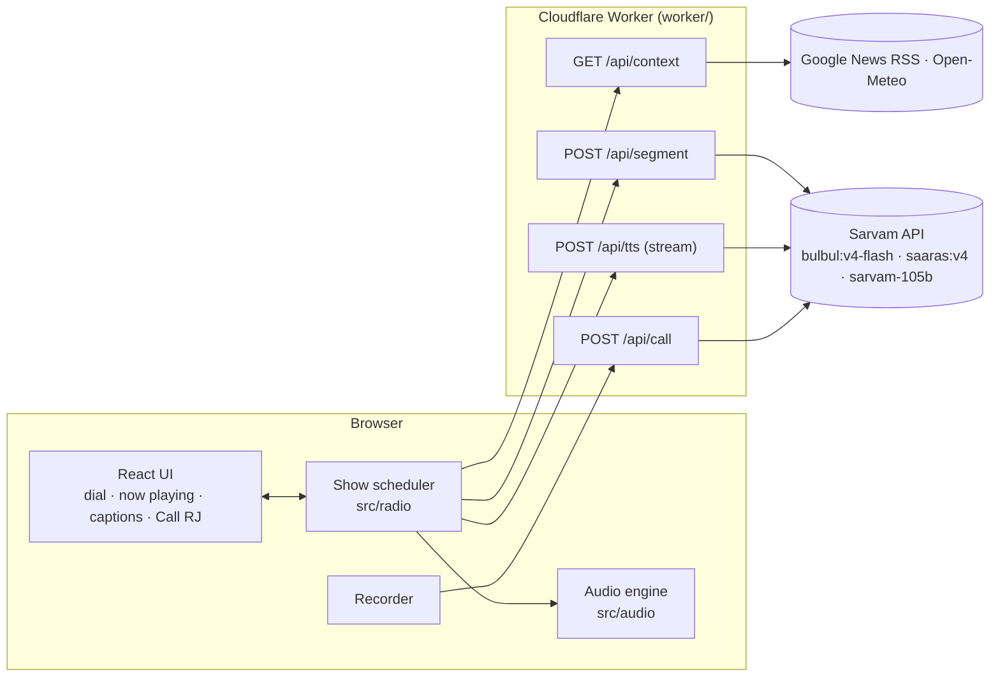

# Tarang FM: Technical Specification

Version 1.0 · 14 Oct 2026 · Product context: [PRD](./PRD.md) · Casting: [VOICE-CASTING.md](./VOICE-CASTING.md) · Work split: [BUILD-PLAN.md](./BUILD-PLAN.md)

The **contracts** in §4 (shared types), §5 (HTTP API) and §7 (audio engine interface) are frozen once the scaffold commit lands. Parallel workstreams build against them. Change a contract only with the lead's agreement, and update this doc in the same commit.

---

## 1. Stack

| Layer | Choice | Why |
|---|---|---|
| Frontend | React 19 + Vite 8 + TypeScript + Tailwind CSS 4 | Fast to build. Same stack as earlier projects |
| Backend | Cloudflare **Worker with static assets** (`@cloudflare/vite-plugin`), routing with **Hono 4** | One deploy for UI + API. Streaming responses. Room for Durable Objects (T9) |
| Validation | **zod** | Shared schemas for request bodies and LLM output |
| Audio | Web Audio API (one `AudioContext`). Streamed 16-bit PCM → `AudioBuffer`s | Gapless, low latency, works on iOS Safari. One graph for voice, music bed, SFX and ducking |
| Mic | `MediaRecorder` (webm/opus on Chrome/Firefox, mp4/aac on Safari) | Saaras accepts both |
| Sarvam access | Direct `fetch` to REST endpoints from the Worker. The `sarvamai` SDK (v1.1.12) is used only in Node scripts and as a type reference | Full control of streaming and fewer Worker compatibility risks |
| Tests | Vitest | Pure modules: schemas, WAV/PCM parsing, prompt post-processing, show clock |

Package versions at planning time: vite 8.3, react 19.3, tailwindcss 4.3, @cloudflare/vite-plugin 1.64, hono 4.13, vitest 5.0.

## 2. Architecture



**How a programme plays:**
1. Tune in: unlock the `AudioContext`, start the music bed and fetch `/api/context`.
2. The scheduler takes the next segment type from the show clock and plays the `station_id` line (fixed text, no LLM call).
3. While a segment plays, the scheduler already requests the **next** segment from `/api/segment`.
4. For each line, the client calls `/api/tts`, which streams PCM from Bulbul through the Worker to the engine. Line *i+1* is fetched when line *i* starts.
5. Captions update as each line's playback starts.

## 3. Repository layout

```
shared/            # contracts used by both client and worker (lead owns)
  types.ts         # §4 types
  stations.ts      # station configs + voice casts (from VOICE-CASTING.md)
  schemas.ts       # zod schemas for API bodies and LLM output
worker/            # Cloudflare Worker (Workstream A)
  index.ts         # Hono app, routes, rate limiting
  sarvam.ts        # ttsStream(), transcribe(), chatJson() with retry/backoff
  prompts.ts       # system/user prompts per segment type + call-in
  context.ts       # geo (request.cf), news RSS, weather
  fallbacks.ts     # template lines per station
src/
  audio/           # Workstream B: engine.ts, pcm.ts, music.ts, sfx.ts, recorder.ts
  radio/           # Workstream D: api.ts (typed client), scheduler.ts, store.ts (state)
  components/      # Workstream C: Tuner, Dial, NowPlaying, Captions, CallButton, Footer
  App.tsx, main.tsx, index.css
scripts/           # Node: spike.ts (API checks), audition.ts (voice samples)
docs/
wrangler.jsonc · vite.config.ts · package.json · tsconfig*.json
```

## 4. Shared types (`shared/types.ts`)

```ts
export type StationId = 'hi' | 'ta' | 'bn' | 'mr' | 'en' | 'te' | 'kn' | 'pa' | 'gu';
export type TtsLanguage = 'hi-IN' | 'ta-IN' | 'bn-IN' | 'mr-IN' | 'en-IN' | 'te-IN' | 'kn-IN' | 'pa-IN' | 'gu-IN';

export type Role =
  | 'station_id' | 'rj' | 'news'
  | 'ad_announcer' | 'ad_customer'
  | 'narrator' | 'char_a' | 'char_b' | 'char_kid';

export type SegmentType = 'station_id' | 'rj_link' | 'news' | 'ad_break' | 'kahani';
export type Daypart = 'morning' | 'afternoon' | 'evening' | 'night';
export type GrammaticalGender = 'feminine' | 'masculine';

export interface Voice {
  speaker: string;              // bulbul:v4-flash persona ID, e.g. 'mukul_hi_suspense'
  label: string;                // display name, e.g. 'Mukul · suspense'
  pace: number;                 // 0.5–2.0
  temperature: number;          // 0.01–1.0 (expressiveness)
  gender: GrammaticalGender;    // for script grammar; set from audition
}

export interface Station {
  id: StationId;
  name: string;                 // 'Tarang Hindi'
  nativeName: string;           // 'तरंग हिंदी'
  frequency: string;            // '91.1' (display only)
  language: TtsLanguage;
  languageName: string;         // 'Hindi'
  tagline: string;              // native script
  accent: string;               // CSS colour
  newsFeedUrl: string;          // RSS
  sttMode: 'codemix' | 'transcribe';
  stationIdText: string;        // fixed jingle line, native script
  cast: Record<Role, Voice>;
}

export interface Line {
  role: Role;
  speaker: string;
  text: string;                 // ≤ 220 chars, already cleaned
  en?: string;                  // English subtitle (Sarvam Translate); absent if translation failed or station is English
  pace: number;
  temperature: number;
  pauseAfterMs: number;         // silence after this line
}

export interface Source { title: string; url: string; source?: string }

export interface Segment {
  id: string;                   // uuid
  station: StationId;
  type: SegmentType;
  title: string;                // shown on now-playing card
  lines: Line[];
  sources?: Source[];           // news only
  fallback?: boolean;           // true if template content was used
}

export interface ListenerContext {
  name?: string;                // ≤ 40 chars
  city?: string;
  localTime: string;            // 'HH:mm'
  daypart: Daypart;
}

export interface ContextResponse {
  city?: string; region?: string; country?: string; timezone?: string;
  headlines: Source[];          // may be empty
  weather?: { tempC: number; description: string };   // T3
}

export type CallIntent = 'chat' | 'dedication' | 'story_request' | 'news_request' | 'other';

export interface CallResponse {
  transcript: string;
  transcriptEn?: string;        // English subtitle of what the caller said
  language?: string;            // detected BCP-47
  intent: CallIntent;
  theme?: string;               // for story_request
  reply: Line;                  // RJ line to synthesize via /api/tts
}
```

## 5. HTTP API (Worker)

All routes are JSON unless noted. Errors use `{ error: { code: string, message: string } }` with a matching HTTP status. Every response carries `Server-Timing` (for example `llm;dur=640, tts_ttfb;dur=210`).

### `GET /api/context?station=hi`
- City, region, country and timezone come from `request.cf`. Headlines are the top 4 items from the station's RSS feed, cached for 30 min with the Cache API.
- Response: `ContextResponse`. Never fails hard: on an error it returns `headlines: []`.

### `POST /api/segment`
```json
{ "station": "hi", "type": "kahani", "listener": { "name": "Harsh", "city": "Jammu", "localTime": "21:40", "daypart": "night" },
  "headlines": [{ "title": "...", "url": "..." }], "theme": "भूतिया हवेली", "recentCalls": ["..."], "upNext": "news" }
```
- `headlines` is required for `news` (the client passes the ones it got from `/api/context`).
- `theme` is optional (from a story request).
- `station_id` returns the fixed station line without calling the LLM.
- Other types call Sarvam-105B with `response_format: json_schema` (§8). The server then:
  1. validates with zod
  2. maps role → cast voice (speaker, pace, temperature)
  3. cleans the text (§8.4)
  4. splits lines over 220 chars at sentence boundaries
- After validation, every line's `en` subtitle is filled by `translate()` in parallel (Sarvam Translate `mayura:v1`, `modern-colloquial`, target `en-IN`). A failed translation leaves `en` undefined and never fails the segment.
- On LLM failure it retries once, then returns a template segment with `fallback: true`.
- Response: `Segment`.
- Timeout: 20 s (the client requests the next segment a full segment ahead, so this isn't on the critical path).

### `POST /api/tts`
```json
{ "station": "hi", "speaker": "simran_hi_news_breaking", "text": "...", "pace": 1.05, "temperature": 0.4 }
```
- Checks that `speaker` is in **some station's cast** (allowlist), that `text` is 1–300 chars, and that `pace` and `temperature` are in range.
- Streams to `POST https://api.sarvam.ai/text-to-speech/stream` with:
  `{ model: "bulbul:v4-flash", language_code: <station language>, speaker, text, pace, temperature, speech_sample_rate: 24000, output_audio_codec: "linear16", enable_preprocessing: true }`
- The upstream body is piped straight to the client (no buffering).
- Response headers: `Content-Type: audio/pcm;rate=24000;bits=16;channels=1` and `X-Audio-Format: pcm`.
- **Spike-verified:**
  - `linear16` returns `content-type: audio/pcm` with raw headerless 16-bit LE mono PCM at 24 kHz, streamed in about 30+ chunks.
  - `wav` returns a 44-byte RIFF header with size fields `0xFFFFFFFF`, followed by PCM.
  - Warm TTFB is about 190–340 ms.
  - The client reader still handles both: if the stream starts with `RIFF`, skip to the `data` chunk payload.

### `POST /api/call` (multipart/form-data)
- Fields:
  - `audio`: Blob, ≤ 2 MB, ≤ 15 s
  - `station`
  - `listener`: JSON string
  - `nowPlaying`: optional segment title
- Pipeline:
  1. **STT:** `POST https://api.sarvam.ai/speech-to-text` (multipart) with `model=saaras:v4`, `language_code=<station language>`, and `mode=<station.sttMode>`. An empty transcript gets a "line not clear" reply.
  2. **LLM:** `POST https://api.sarvam.ai/v1/chat/completions` with `model: "sarvam-105b"` and `reasoning_effort: null`, `max_tokens: 400`, `temperature: 0.7`, json_schema `{ intent, reply, theme }`. Timeout 8 s, then a template reply.
  3. Translate the transcript and reply to English (in parallel, best-effort) for `transcriptEn` and `reply.en`.
  4. Return `CallResponse`. The client then calls `/api/tts` with `reply` (two round trips, which keeps the API simple).
- Caller audio is never stored.

### Rate limits (Workers rate-limiting binding, per IP)
| Route | Limit |
|---|---|
| `/api/segment` | 30 / min |
| `/api/tts` | 120 / min |
| `/api/call` | 8 / min |

### Secrets and config
- `SARVAM_API_KEY`: `.dev.vars` locally (gitignored) and `wrangler secret put SARVAM_API_KEY` in production.
- `wrangler.jsonc`: `main: "worker/index.ts"`, `assets: { not_found_handling: "single-page-application" }`, `compatibility_flags: ["nodejs_compat"]`, `observability.enabled: true`, plus `ratelimits` bindings.

## 6. Sarvam calls (`worker/sarvam.ts`)

| Function | Endpoint | Notes |
|---|---|---|
| `ttsStream(body)` | `POST /text-to-speech/stream` | Returns the upstream `Response`. Retries 429/5xx up to 2 times **before** the first byte (backoff 300 ms × 2ⁿ, jittered) |
| `transcribe(blob, opts)` | `POST /speech-to-text` | multipart `file`, `model`, `language_code`, `mode`. Returns `{ transcript, language_code }` |
| `chatJson(messages, schema, opts)` | `POST /v1/chat/completions` | `response_format: { type: "json_schema", json_schema: { name, schema, strict: true } }`. If the model wraps JSON in prose or fences, extract the first `{…}` block and validate with zod. Spike: `sarvam-105b` with `reasoning_effort: null` returned valid JSON in 1.3 s with 0 reasoning tokens |
| `translate(text, source, target='en-IN')` | `POST /translate` | `{ input, source_language_code, target_language_code, model: "mayura:v1", mode: "modern-colloquial" }` → `translated_text`. Input ≤ 1,000 chars. Best-effort with a 4 s timeout |

- Auth header on every call: `api-subscription-key: ${env.SARVAM_API_KEY}`.
- Log the `request_id` from error bodies.

## 7. Audio engine (`src/audio`)

### Interface (consumed by the scheduler)
```ts
export interface AudioEngine {
  unlock(): Promise<void>;                                  // call inside the Tune in click handler
  playStream(res: Response, opts?: { onStart?: () => void }): Promise<{ ttfaMs: number; durationMs: number }>;
  stopVoice(fadeMs?: number): void;                         // barge-in / station switch
  silence(ms: number): Promise<void>;                       // pauseAfterMs between lines
  music: { start(accent?: string): void; stop(fadeMs?: number): void };
  sfx: { sting(): Promise<void>; callTone(): Promise<void>; tuneStatic(ms: number): Promise<void> };
  analyser: AnalyserNode;                                   // for T4 visualizer
}
export interface Recorder {
  start(): Promise<void>;                                   // asks for mic permission on first use
  stop(): Promise<Blob>;                                    // auto-stops at 15 s
  level(): number;                                          // 0..1 RMS for the meter
}
```

### Graph
```
PCM chunks → AudioBufferSource ─┐
                                 ├→ voiceGain ─→ compressor ─┐
music bed (oscillators+noise) → musicGain (ducked) ──────────┼→ master → analyser → destination
sfx (sting, call tone, static) → sfxGain ────────────────────┘
```

- **PCM streaming:**
  - Read the `Response.body` stream.
  - Carry over an odd trailing byte between chunks.
  - Convert Int16LE to Float32 and create a 24 kHz mono `AudioBuffer` per ~100 ms.
  - Schedule each at `max(ctx.currentTime + 0.03, nextStart)`. Resolve when the last source ends.
  - TTFA is the time from `fetch` start to the first scheduled sample.
- **Ducking:** while the voice is active, `musicGain` ramps to 0.08 over 150 ms. After 400 ms of voice silence it returns to 0.25.
- **Music bed (procedural, royalty-free):** a soft tanpura-like drone (root + fifth on sawtooth through a slowly swept low-pass filter) plus a gentle pad. The key is chosen per station.
- **Sting:** a 4-note bell arpeggio (FM synthesis), about 1.2 s.
- **iOS:** create and resume the `AudioContext` in the click handler. Never call `play` before `unlock()`.

## 8. LLM design (`worker/prompts.ts`)

### 8.1 Shared system preamble (all segment types)
> You are the script writer for "{station.name}", a lively Indian FM radio station broadcasting in {languageName}. Write ONLY in {languageName} using its native script; English words may stay in Latin script. Never write romanized {languageName}. Use short spoken sentences (max 200 characters per line), sentence punctuation (use । for Hindi, Marathi and Bangla), and numbers as digits. No SSML, markdown, emojis, stage directions or sound-effect cues. Family-friendly. Never mention real brands, politicians or celebrities. Output JSON matching the schema exactly.

It is followed by a **cast sheet** listing each allowed role with its grammatical gender (from `Voice.gender`), so Hindi, Marathi and similar languages conjugate verbs correctly.

### 8.2 Per-type instructions and schemas
| Type | Roles allowed | Lines | Instructions | Temp | Reasoning |
|---|---|---|---|---|---|
| `rj_link` | `rj` | 2–4 | Greet the listener by name (if given) and city, mention the time of day, tease the next segment type, add one playful remark | 0.9 | null |
| `news` | `news` | 4–6 | Intro line, then one line per supplied headline **rephrased only** (no new facts, numbers or opinions), then a sign-off. If no headlines, return 0 lines | 0.3 | null |
| `ad_break` | `ad_announcer`, `ad_customer` | 4–6 | One fictional, absurd but believable desi product. Customer problem → product → funny tagline. End with a fast "terms and conditions" joke | 1.0 | low |
| `kahani` | `narrator`, `char_a`, `char_b`, `char_kid` | 8–12 | Complete mini story with a title, a hook in line 1, dialogue between characters and a twist ending. Use `theme` if given, otherwise pick one suited to the daypart. Narrator ≤ 40 % of lines | 0.95 | low |

**Segment output schema:**
```json
{ "type": "object", "additionalProperties": false, "required": ["title", "lines"],
  "properties": {
    "title": { "type": "string", "maxLength": 80 },
    "lines": { "type": "array", "maxItems": 14, "items": {
      "type": "object", "additionalProperties": false, "required": ["role", "text"],
      "properties": { "role": { "enum": ["<roles allowed for this type>"] }, "text": { "type": "string", "maxLength": 400 } } } } } }
```
`max_tokens`: 1,800 for `kahani`/`ad_break` (reasoning tokens count toward it) and 800 otherwise.

### 8.3 Call-in prompt
- **System:** you are the RJ of {station} (cast sheet for `rj`). A listener is calling live. Reply on air in {languageName} in at most 2 sentences (≤ 220 chars), warm and witty, using the caller's name if known.
  - Classify `intent`: `chat`, `dedication`, `story_request` (extract a short `theme` in {languageName}), `news_request`, or `other`.
  - For abusive or unsafe input, set `intent: "other"` and deflect politely.
  - Never repeat personal data like phone numbers.
- **User message:** a JSON object with `{ transcript, listener, nowPlaying }`.
- **Schema:** `{ intent: enum, reply: string ≤ 300, theme: string | null }`.

### 8.4 Post-processing (`cleanText`)
- Strip markdown, emojis, bracketed stage directions and quotation marks around whole lines.
- Collapse whitespace.
- Make sure each line ends with sentence punctuation.
- Split lines over 220 chars at `।`, `.`, `?` or `!`.
- Drop empty lines. Drop roles that aren't allowed (or map them to `narrator` for `kahani`).

### 8.5 Fallbacks (`worker/fallbacks.ts`)
Each station has 3 template RJ filler lines, for example "आप सुन रहे हैं तरंग FM… बने रहिए हमारे साथ!". They're used when a segment fails twice. News failure means news is skipped.

## 9. Show scheduler (`src/radio`)

- **Clock:** `['station_id','rj_link','news','ad_break','kahani','rj_link','ad_break','kahani']`, looping from index 1 after the first pass.
- **State (store):**
  `{ status: 'idle'|'tuning'|'playing'|'paused'|'call_recording'|'call_thinking'|'call_on_air', station, segment, lineIndex, caption: { speaker, label, text, role }, callTranscript?, ttfaMs?, error? }`
- **Prefetch:**
  - When segment *n* starts, request segment *n+1*.
  - When line *i* starts, start the `/api/tts` fetch for line *i+1* and hold the `Response` until it's played.
- **Station switch:**
  1. `stopVoice(150)` and drop pending prefetches (AbortController).
  2. Play static (T4) or the sting.
  3. Start the new station at `station_id`.
- **Call-in:**
  1. On press, `stopVoice(200)` and remember the position, then record.
  2. On release, POST `/api/call`, play `callTone`, then stream the reply.
  3. If the intent is `story_request`, make the next queued segment a `kahani` with that `theme`.
  4. Resume from the next line.
- **Errors:** a failed segment fetch skips to the next clock entry. A failed line TTS shows the caption for 2 s and moves on.

## 10. Context sources (`worker/context.ts`)

| Data | Source | Cache |
|---|---|---|
| City, region, timezone | `request.cf` | – |
| Headlines | Google News RSS: `https://news.google.com/rss?hl={hl}&gl=IN&ceid=IN:{hl}` with `hl` = `hi`, `ta`, `bn` (also `mr`, `te`, `kn`, `pa`, `gu`). Parse `<item><title>`, `<link>`, `<source>` with regex (no XML lib). Strip the " - Source" suffix from titles | Cache API, 30 min |
| Weather (T3) | `https://api.open-meteo.com/v1/forecast?latitude={lat}&longitude={lon}&current=temperature_2m,weather_code` (credit Open-Meteo in the footer) | Cache API, 15 min |

## 11. Testing and verification

- **Unit tests (Vitest):** `cleanText` + line splitting, zod schemas, PCM chunk converter (odd-byte carry-over, WAV header skip), scheduler clock progression.
- **Spike (`npm run spike`), run 14 Oct 2026. Results:**
  - **TTS:** `linear16` streams raw PCM (`audio/pcm`). `wav` streams a RIFF header with `0xFFFFFFFF` sizes. Warm TTFB is 190–340 ms; a cold first call is about 530 ms, and one `en-IN` outlier hit 2.8 s.
  - **Params:** `temperature`, `pitch` and `loudness` are all accepted on v4-flash. A Hindi persona with `ta-IN` text works.
  - **Speaker IDs:** some docs IDs are stale (`vetri_ta_*` → `aravind_ta_*`, `bappa_bn_*` → `arnab_bn_*`). An invalid speaker returns 400 listing all 224 live IDs. The live list is saved locally, and `npm run audition` verifies the cast.
  - **Chat:** `json_schema` on `sarvam-105b` with `reasoning_effort: null` gives valid JSON in 1.3 s with 0 reasoning tokens.
  - **STT:** Saaras v4 (`codemix` and `transcribe`) takes about 400 ms for an 8 s clip and is accurate. `codemix` keeps "FM" in Latin script.
  - **News:** Google News RSS returns 26 items each for `hl=hi`, `ta` and `bn`. Titles end with " - Source".
- **Voice audition (`npm run audition`):** median-F0 classification of every cast voice. Results are in VOICE-CASTING.md.
- **Manual QA matrix before submission:** Chrome desktop, Android Chrome, iOS Safari. For each: tune in, switch stations, call in (Hindi and Tamil), 10 minutes of continuous play with no dead air.

## 12. Platform features used

Each feature has a job. Nothing is added just to tick a box.

| Platform | Feature | Used for | Tier |
|---|---|---|---|
| Sarvam | **Bulbul v4 Flash** HTTP streaming (`linear16`) | Every spoken line, with 14+ personas cast by style | MVP |
| Sarvam | **Sarvam-105B** structured outputs (`json_schema`) | Radio scripts (RJ, news, ads, Kahani) and call-in understanding | MVP |
| Sarvam | **Saaras v4** STT (`codemix` / `transcribe`) | Call-in transcription | MVP |
| Sarvam | **Translate** (`mayura:v1`, modern-colloquial) | English subtitles under native captions, so non-native listeners and judges can follow | MVP |
| Sarvam | Bulbul **WebSocket** streaming | Call-in reply: stream LLM sentences into TTS for faster first audio | If time |
| Sarvam | **Transliterate** | "Read along" romanized captions | If time |
| Cloudflare | **Workers + static assets** (Vite plugin) | UI + API in one deploy | MVP |
| Cloudflare | **Rate-limiting binding** | Per-IP protection for `/api/segment`, `/api/tts`, `/api/call` | MVP |
| Cloudflare | **Cache API** | News RSS (30 min) and weather (15 min) | MVP |
| Cloudflare | `request.cf` geolocation | Listener city, region and timezone for personalization, with no permission prompt | MVP |
| Cloudflare | Workers Logs / observability | Timings and errors per request (`Server-Timing`) | MVP |
| Cloudflare | **Cron Triggers + KV** | Pre-build each station's news bulletin script every 30 min, so news starts instantly | If time |
| Cloudflare | **R2** | Audio cache for share-a-clip and instant replays | If time |
| Cloudflare | **D1** | "Dedication wall": recent on-air dedications per station | If time |
| Cloudflare | **Analytics Engine** | Listen and call-in counts and TTFA percentiles for a live stats panel | If time |
| Cloudflare | **Durable Objects** (WebSocket hibernation) | Live broadcast mode: one shared timeline per station, call-ins heard by everyone | If time (last) |

## 13. Commands (to be filled in once the scaffold exists)
```
npm run dev       # Vite + Worker locally (needs .dev.vars with SARVAM_API_KEY)
npm run build     # production build
npm run deploy    # build + wrangler deploy
npm test          # vitest
npx tsx scripts/spike.ts
```
